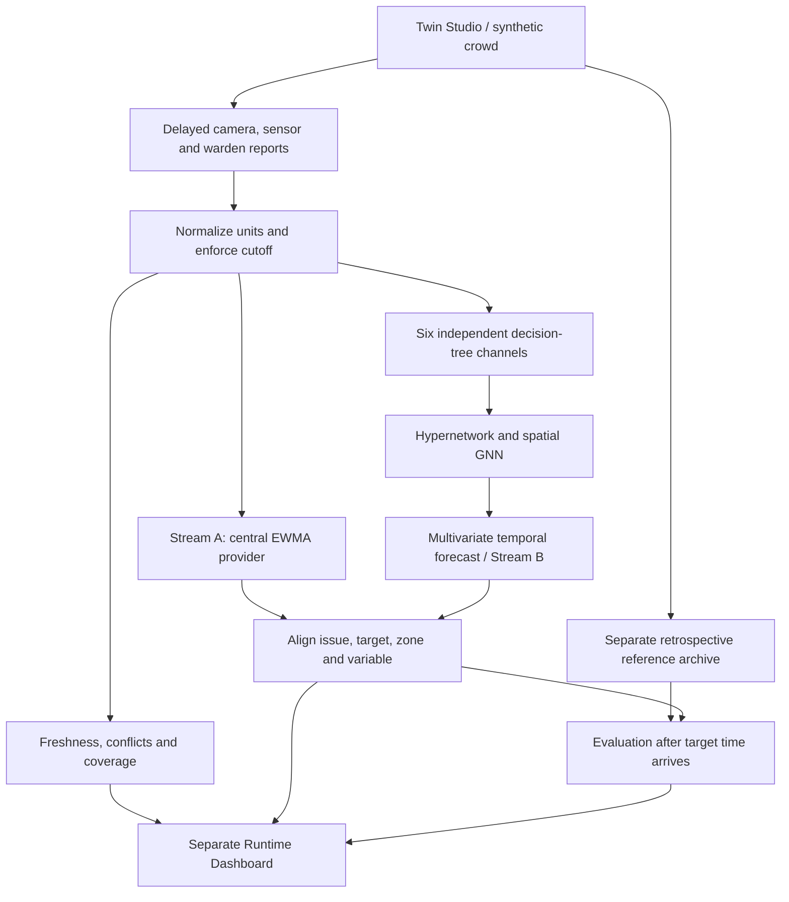

# Current integrated launch

Use `START_REVIEW_WINDOWS.bat` (Python 3.11/3.12), or `python start_review.py`. It opens the combined random-flow and forecasting dashboard on a printed localhost URL. Studio is at the same origin's `/` route. First start installs CPU dependencies; no publishing occurs.

The dashboard generates constrained curved routes from density, direction, duration and seed; hidden random incidents become visible only as the world reaches them. Forecasting sees only released observation reports. Compare clearance actions pauses the world and tests estimates from current reports. The model is experimental, and the recorded curved stress tests include missed warnings and false alarms.

Current contracts, model-directory distinctions and known missing feedback/promotion features are in [docs/IMPLEMENTATION_STATUS.md](docs/IMPLEMENTATION_STATUS.md), [docs/ARCHITECTURE.md](docs/ARCHITECTURE.md) and [docs/INTEGRATION_AUDIT_RECONCILIATION.md](docs/INTEGRATION_AUDIT_RECONCILIATION.md).

---

## Historical two-service Studio launch instructions

The instructions below describe the earlier manual-route/replay mode. Its original `models/production` checkpoint is untrained; the combined review launcher instead selects the separate historical synthetic `models/candidates/mc_v2` checkpoint. Neither is a validated model for arbitrary venues.

# Event Horizon — integrated simulator and backend runtime

## Start on Windows

Use Python **3.11 or 3.12**. Extract the ZIP, then double-click **START_WINDOWS.bat in this top-level folder**. The first launch installs dependencies into `.venv` and can take several minutes, especially PyTorch.

The launcher starts two separate services and opens the simulator first:

- **Twin Studio**: http://127.0.0.1:8000/
- **Runtime Dashboard**: http://127.0.0.1:8001/dashboard/

These are separate full-page frontends. There are no split-screen simulators, embedded dashboard windows, or iframes.

1. Keep the original venue/floor plan, or upload your own image.
2. Draw routes or **Open project** → `studio/examples/event_horizon_scene.json` for an immediately runnable venue scenario.
3. Set population, speed and incidents. **Clear all routes** removes routes, drafts and their incidents while retaining the floor plan/image.
4. Open **Runs → Render all three**. The runtime automatically connects and processes simulation time zero.
5. Choose Ideal / Your scenario / Unscripted and press **Play**. Runtime input follows playback time; pausing stops new cutoffs. The feed status below the transport shows how far inference has processed.
6. Click **Dashboard ↗**. The separate backend frontend follows the latest runtime session automatically. Selecting an older session pins that session.
7. Choose a route, variable and horizon. Read central and architecture forecasts beside matured actuals and the current evidence trust score. Download the comparison CSV or print the displayed report.

Seeking creates a fresh runtime session and replays observations in order from zero to the sought time. Switching scenarios does the same, preserving scenario isolation. **Reconnect runtime** replays to the current simulator clock after a connection failure.

## Start manually

```bash
python -m venv .venv
# Windows:
.venv\Scripts\activate
# Linux/macOS:
# source .venv/bin/activate
python -m pip install -r requirements.runtime.txt
python start_integrated.py
```

Occupied ports:

```bash
python start_integrated.py --studio-port 8010 --runtime-port 8011
```

The Dashboard link adjusts to the configured runtime port. Ctrl+C stops both services. There is no login or paid external service.

## Data path and architecture



The original `crowd_reliability` pipeline is used; it has not been replaced by frontend mock predictions. Runtime inputs contain route geometry and timestamped observations. They do not contain incident schedules, population settings, simulation seeds, rendered frames or hidden reference labels.

- Studio remains the authoritative synthetic generator. Delayed/missing/noisy sources retain `observed_at_s` and `available_at_s`.
- The normalizer maps camera density/speed, sensor entry/exit counts and warden queues/gate reports to the backend's six variables and units. No missing gate state is inferred from a collapse label or lack of traffic.
- One route corridor is one measurable model zone. Its area is route length × width. Intersecting/overlapping route corridors become graph neighbors, including crossings without shared vertices. Overlapping zones are not a disjoint occupancy map; do not sum their area to infer unique venue capacity.
- Each route endpoint is treated as an exit for variable applicability. This is a route-level surrogate, not a calibrated room/door graph. Smaller venue zones require appropriately localized measurements.
- All six tree channel values and masks remain separate. The supplied hypernetwork/GNN and temporal model run at five-second intervals, with 30/60/120-second forecast horizons.
- Stream A remains the repository's independent observation-only synthetic central EWMA provider, with its two-second receipt delay. It is explicitly identified as synthetic.
- Forecasts compare exact issue time and exact target time, avoiding accidental comparison of different vintages. Each stream appears only after its receipt time.
- Actuals enter a separate evaluation store through `/evaluation`, only at times reached by the inference clock. Future labels and future reports are rejected. The inference functions do not read that store. Reference actuals have zero additional label delay in this local retrospective demo.
- Inference and evaluation are separated by APIs and data stores inside this local backend, not separate OS security domains. Run the original observation-only service and a separately isolated evaluator for stronger deployment isolation.

## Trust and accuracy

The architecture's independent freshness/conflict labels, coverage and six tree signals remain intact. The requested dashboard **trust score** is a transparent presentation-only evidence index:

`100 × exp(-observation_age_seconds / 45) × min(1, fresh independent sources / 2) × conflict_factor × rapid_change_factor`

Conflict factor = 0.5 if conflicting; otherwise 1. Rapid-change factor = 0.75 if changing rapidly; otherwise 1. A fresh source is independently identified and has an observation no older than 90 seconds. No observation means **Unavailable**, rather than a fabricated score. These display constants are not learned or validated source reliability probabilities.

Trust is evaluated at the dashboard clock and shown beside every comparison. It is **not** a forecast's historical issue-time trust score or forecast accuracy. The report's `trust_score` has this same current-clock meaning. The overview averages available per-variable evidence scores. Original flags remain visible independently. Accuracy uses MAE/RMSE on matured forecast targets, separately by stream, variable and horizon across all routes. No future actual data enters inference or accuracy calculations.

## Supplied model status and limits

The supplied manifest labels **hypernetwork, GNN and temporal stages `untrained_initial`**. The runtime runs the supplied weights and displays their predictions as **experimental**. It does not train or claim to validate them. The saved spatial artifacts are first hash-verified against their original graph. Their graph-independent shared weights are then applied inductively to the user route graph; that venue transfer is explicitly experimental and is rejected in strict validated-model mode.

The uploaded trees record scikit-learn 1.9.1 in their pickle metadata. This integration was exercised on scikit-learn 1.8.0, which emits version mismatch warnings. Use a matching model training/serving environment or retrain/export the trees on the chosen environment before validated use. Do not treat passing integration tests as model validation. The original full lockfile is retained, alongside the smaller tested runtime requirements.

Simulation is a seeded kinematic model, not a validated crowd safety predictor. The venue is sketch-derived and needs physical calibration. Reports are synthetic. Runtime state is held in memory (up to 30 sessions); export reports before restarting. Studio render archives and decision journals remain on disk under `studio/outputs`. The backend may lag fast playback; the feed indicator shows the actual inference clock. No frames or forecast cutoffs are skipped.

## Files changed or added

- `crowd_reliability/runtime.py`: live sessions, input validation, normalizer, supplied model calls, evidence index, retrospective comparison and exports.
- `runtime_server.py`: existing FastAPI backend plus runtime APIs and the new standalone frontend.
- `runtime_frontend/`: Dashboard component, chart, comparison table, evidence details, model readiness and report exports.
- `studio/dist/live.js`: ordered feed, scenario/seek isolation and reconnect.
- `studio/dist/app.js`, `index.html`, `style.css`: feed hooks, separate Dashboard link and clear-routes control.
- `studio/lab_server.py`: same-origin runtime proxy, runtime URL discovery and separate cutoff evaluation labels.
- `studio/observations.py`: delayed warden gate observations generated from the gate state at the measurement's own time.
- `start_integrated.py`, `START_WINDOWS.bat`, `requirements.runtime.txt`: one launch for both services.

Original backend source, original model artifacts, simulator floor plan, 3D view, heatmaps, journals, three CSV outputs and master report functions are retained. Original per-project READMEs remain as historical documentation; follow this file to start the integrated build.

## Verification

```bash
python -m pip install pytest httpx2
python -m pytest tests/test_live_runtime.py tests/test_pipeline.py tests/test_channels.py tests/test_spatial_contract.py tests/test_spatial_leakage.py tests/test_readiness.py tests/test_central_source.py -q
python tests/live_http_smoke.py
cd studio
node test_ui.js
node test_live.js
node test_engine.js
node test_regressions.js
python -m unittest test_backend test_observations
```

Checks cover live causal cutoffs, rejected future labels, idempotent clock retries, six-channel preservation, actuals isolated from model inputs, model artifact readiness, exact forecast alignment, real HTTP render → proxy → inference → dashboard/report, route clearing with retained plan, reconnects and the existing simulation regressions. Browser rendering was not visually verified in this environment; automated UI checks use a DOM harness.

Implementation assistance: OpenAI Codex. Existing PyTorch, scikit-learn, FastAPI and the supplied project resources are retained. All runtime input in this build is synthetic.
