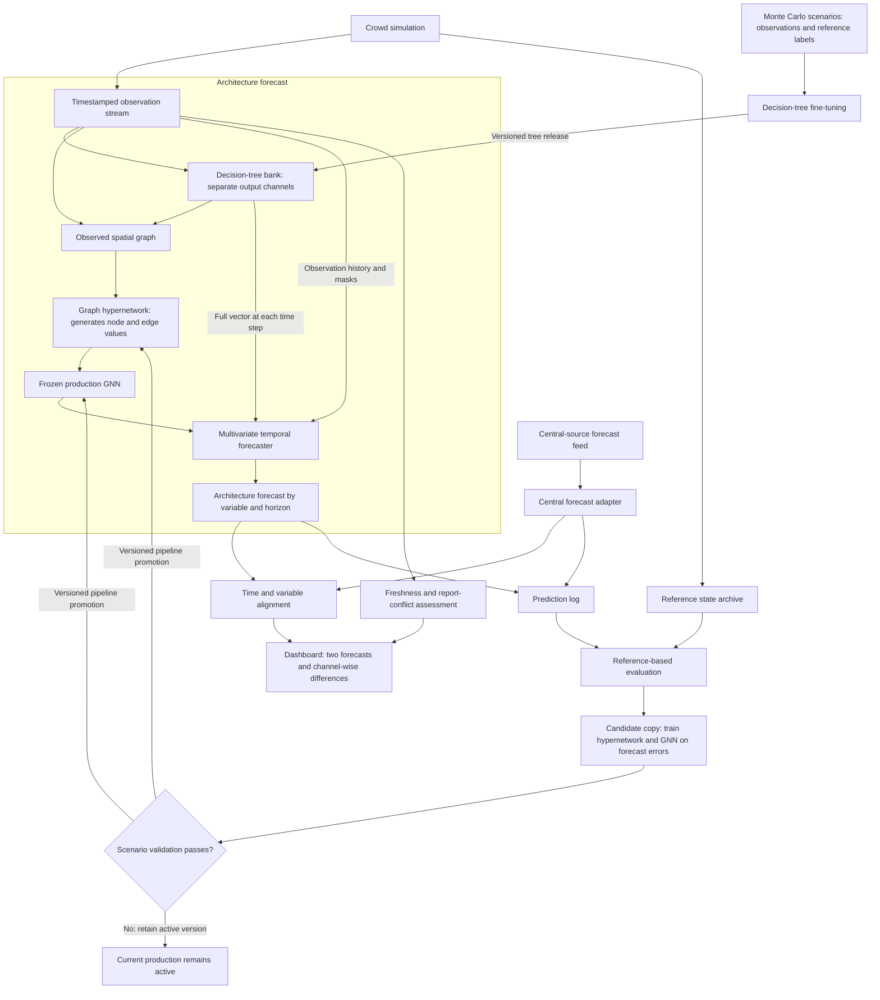
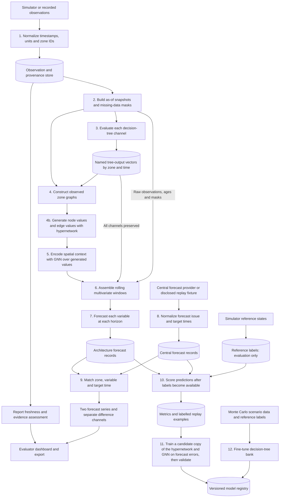
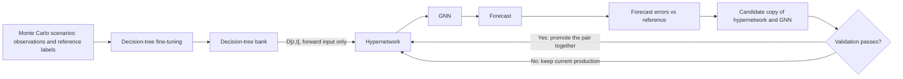

# Crowd Disaster Information Reliability
## Architecture and dataflow specification

**Version:** 0.1 · **Date:** 14 October 2026  
**Status:** Proposed architecture for a crowd-disaster simulation prototype. This document is a design specification, not a claim of completed implementation or measured performance.  
**Project title:** Working descriptive title; replace with the team's approved name.

## 1. Purpose and scope

The system assesses whether crowd-related information remains useful as simulated conditions evolve. It combines report freshness, geographic relationships, multivariate forecasting and comparison with a central forecast source.

The scope covers crowd density, speed, directional flow, queue length and exit availability across a venue's zones. The system presents two distinguishable forecast streams:

- **Stream A — central-source forecast:** imported forecast values from the configured central source.
- **Stream B — architecture forecast:** values produced by the decision-tree bank, graph hypernetwork, spatial GNN and temporal forecasting pipeline.

The central source has not yet been identified. “Central” denotes the configured upstream provider; it does not imply an official authority or guaranteed correctness. In a self-contained demonstration, a replay fixture or separate baseline can stand in for this source and must be labelled accordingly.

## 2. Non-negotiable representation rule

**Decision-tree outputs remain a named, multidimensional time series. They must not be averaged, summed or otherwise reduced to a single trust signal before forecasting.**

For each zone z and evaluation time t, retain:

```text
D[z,t] = [
  estimated_density,
  estimated_speed,
  estimated_inflow,
  estimated_outflow,
  estimated_queue_length,
  probability_exit_open
]
```

These are proposed tree targets: each tree estimates one component of the current crowd state from the observations available at t. Their labels come from the simulator's reference state at t. Additional trees may be introduced as separately named channels with documented units and targets.

Exit availability applies only to relevant zones; use an applicability mask elsewhere. Missing channels retain an explicit missing-data mask rather than being replaced with a meaningful zero.

The tree vector is:
1. Part of the dynamic context input to the graph hypernetwork, which generates the node values the GNN operates on.
2. Passed directly into the temporal forecaster at every time step.
3. Retained in stored records and evaluator exports.

GNN embeddings and hypernetwork-generated values may encode spatial context, but the direct tree-vector path preserves access to every original channel.

## 3. Architecture diagram



The gate promotes the hypernetwork and GNN together as one atomic release, because the GNN consumes the hypernetwork's generated values; they are not independent live edits. Forecast errors feed back only into this pair. The decision-tree bank is fine-tuned separately from Monte Carlo scenario data and reference labels. It receives no forecast-error feedback, and nothing flows back from the trees to the hypernetwork: the tree vector D enters the hypernetwork as a forward input only. The temporal forecaster is not changed by the loop. Every release produces a new pipeline version that records all component versions.

## 4. Component responsibilities

| Component | Responsibility | Main output |
| --- | --- | --- |
| Crowd simulator | Execute venue layouts and pedestrian scenarios with reproducible configuration | Reference states and simulated observations |
| Observation generator | Apply configured sampling intervals, report delays and observation availability | Timestamped, source-labelled reports |
| Normalizer | Match zones, units, clock fields and report identities | Structured observation records |
| Decision-tree bank | Estimate separate current-state variables from observed context | Named multivariate vector D |
| Spatial graph builder | Connect zones through physical pedestrian routes | As-of node features and edge attributes |
| Graph hypernetwork | Generate the node values and edge values the GNN operates on, conditioned on static zone/link descriptors and the current observed state including the full tree vector | Node values and edge values per zone/link and time |
| Production GNN | Encode relationships between connected zones over the generated node and edge values | Spatial embedding per zone and time |
| Temporal forecaster | Learn temporal evolution from full tree vectors, observations and embeddings | Architecture forecast tensor |
| Central-source adapter | Import and standardize upstream forecasts without relabelling them as truth | Central forecast records |
| Comparison service | Align forecasts and compute variable-specific differences | Paired forecasts and difference vectors |
| Information assessment | Track observation age, report disagreements and evidence availability | Separate freshness, conflict and coverage fields |
| Evaluation worker | Compare saved predictions with corresponding reference states | Per-variable, per-horizon metrics |
| Candidate trainer | Update models on labelled examples and replay data | Candidate pipeline artifact |
| Model registry | Track and promote compatible pipeline versions | Active and candidate manifests |
| Dashboard | Display both streams, report evidence and results | Zone view, time-series plots and exports |

## 5. Spatial and temporal representation

### Spatial graph

- **Nodes:** corridors, entrances, exits, stairways and assembly zones.
- **Edges:** physical pedestrian connections, optionally directed.
- **Node features:** reported crowd variables, observation ages, report availability, source metadata and the full tree vector.
- **Edge attributes:** width, direction, distance and currently reported restrictions.
- **Reference state:** held separately for evaluation and training-label generation.

Geographic segmentation is defined by the venue map. The initial tree bank operates on zone features; it does not need to discover the venue layout.

### Graph hypernetwork

The GNN does not consume hand-built node features and static edge attributes directly. A hypernetwork generates both from context:

- **Node values** Vn[z,t] (16-dimensional) are generated per zone from the zone's static descriptors (zone-type one-hot, normalized capacity and area, exit flag) and its dynamic context: observed variables, observation ages, missing-data masks and the full six-channel tree vector D[z,t].
- **Edge values** Ve[e,t] (4-dimensional, non-negative through a softplus output) are generated per connection from the link's static geometry (normalized width and distance) and the latent codes of its two endpoint zones. A link's effective behaviour, for example a capacity-like or flow-resistance-like quantity, therefore depends on the current state of the zones it joins.

The hypernetwork is a small MLP: a shared node encoder, a node head, and an edge encoder and head that read both endpoint codes. D[z,t] enters it unreduced and still reaches the temporal forecaster through the direct path. The generated values are retained for inspection and are not used to replace any displayed forecast output. The hypernetwork is versioned and promoted with the rest of the pipeline.

### Forecasting input and output

Let X[t] be the observed node features, E[t] the edge attributes and A[t] the observed adjacency.

```text
(Vn[t], Ve[t]) = HyperNet(S_node, X[t], D[t], S_edge, A[t])
H[t] = GNN(Vn[t], A[t], Ve[t])

U[z,t] = concatenate(
    X[z,t],
    D[z,t],
    H[z,t],
    observation_age[z,t],
    missing_and_applicability_masks[z,t]
)

ArchitectureForecast[z,t] =
    TemporalModel(U[z,t-L+1], ..., U[z,t])
```

L is the history-window length. The temporal output has shape:

```text
[number_of_zones, number_of_forecast_horizons, number_of_target_variables]
```

Each target remains identifiable. Density, speed, inflow, outflow and queue length are numeric forecast heads. Exit availability uses a probability head with an applicability mask. No single aggregate score replaces these forecasts.

**Illustrative initial configuration:** 5-second observation steps, a 60-step history window, and horizons of 30, 60 and 120 seconds. These are tunable design defaults, not experimentally selected values.

A small MLP hypernetwork, a two-layer edge-aware GNN and a small GRU are proposed starting models. Numeric scaling is fitted on training data and inverted for display. The tree bank, scalers, feature order and target definitions are versioned with the neural models.

## 6. Two-stream forecast comparison

Normalize both streams to the same zone IDs, variables, units and target timestamps. At evaluation time t, use only forecasts issued and received by t. Prefer matched issue times for head-to-head model evaluation; when latest-available forecasts differ in age, display both issue times and lead times.

For variable k and target time tau:

```text
difference[z,tau,k] =
    architecture_forecast[z,tau,k] - central_forecast[z,tau,k]
```

Maintain one difference channel per variable. Density differences are in persons per square metre; exit-probability differences are in probability points. Do not compare quantities with incompatible definitions. Unsupported central-source variables remain “unavailable”; they are not fabricated.

The dashboard shows:
- Both forecast curves per variable.
- Each forecast's source, issue time, target time and model version where available.
- Signed and absolute differences per variable.
- Report freshness, explicit conflicts and evidence coverage separately.
- Reference outcomes and measured errors once available.

Forecast disagreement triggers a review indication. It does not identify which stream is correct. A stale “low density” report can be marked for re-verification when the architecture forecasts a substantial change, while the forecast is still displayed as a forecast.

## 7. Dataflow diagram



## 8. Data contracts

| Record | Required fields |
| --- | --- |
| Zone | zone_id, geometry, zone_type, capacity_definition, map_version |
| Connection | edge_id, from_zone, to_zone, width_m, direction, map_version |
| Observation | report_id, scenario_id, zone_id, source_id, variable, value, unit, observed_at, published_at, received_at |
| Tree output | scenario_id, zone_id, evaluation_time, tree_version, channel_names, channel_values, channel_masks |
| Forecast | forecast_id, stream_id, scenario_id, zone_id, variable, unit, issued_at, received_at, target_at, value, model_or_provider_version |
| Reference state | scenario_id, zone_id, variable, value, unit, state_at, label_available_at |
| Assessment | report_id or forecast_id, evaluated_at, observation_age, conflict_ids, coverage, per_variable_flags |
| Model manifest | pipeline_version, tree_version, hypernet_version, gnn_version, temporal_version, scaler_version, schema_version, training_cutoff, scenario_split |

Store times in UTC and preserve simulation time explicitly when replay uses a relative clock. Retain source timestamps rather than assigning receipt time as observation time.

## 9. Training and feedback

1. Generate or replay scenarios with reference state archived separately.
2. Build training inputs exclusively from the observed stream available at each prediction time.
3. Train and fine-tune the tree bank on Monte Carlo scenario data against its documented per-variable current-state targets (section 10).
4. Produce chronological out-of-sample tree outputs for neural-model training.
5. Train the hypernetwork, GNN and temporal model on sequences of observed features, tree vectors and spatial context; supervise forecasts using reference outcomes at their target times.
6. Log production predictions with all required versions before receiving their labels.
7. When labels become available, calculate per-variable forecast errors and create labelled replay examples.
8. Copy the production hypernetwork and GNN and train the candidate copy on forecast errors and representative replay cases, with the tree bank and temporal forecaster held fixed.
9. Fine-tune the decision trees separately, using only Monte Carlo scenario data and simulator reference labels. Forecast errors are not fed to the trees, and nothing is fed back from the trees to the hypernetwork. A new tree version is validated for compatibility with the active hypernetwork and GNN before release.
10. Promote the hypernetwork and GNN candidate as one versioned release only after the defined validation criteria pass. The new pipeline version records every component version.

Production and training use independently loaded model state; the candidate is a copy, and production stays frozen until promotion.

There are two separate update paths:

- **Decision trees:** fine-tuned only from Monte Carlo scenario data against simulator reference labels (section 10). They receive no forecast-error feedback.
- **Hypernetwork and GNN:** the only components in the feedback loop. Forecast errors from production replay train a candidate copy of the pair, which is promoted together after validation. The tree vector D enters the hypernetwork as a forward input only; nothing is fed back from the trees to the hypernetwork. The temporal forecaster is not changed by the loop.

Forecast errors identify cases for training the hypernetwork and GNN, but do not substitute for target labels. Include labelled correct predictions as well as incorrect ones.



Numeric heads can use scaled MSE or Huber loss; the exit head can use binary cross-entropy. A scalar optimization loss is permitted: it combines training objectives, **not the decision-tree input channels or the displayed forecast outputs**.

## 10. Monte Carlo scenario evaluation

Vary crowd arrival rates, destination preferences, route choices, exit restrictions, observation intervals, delays and outages through seeded scenarios. Record the sampled parameters with every run.

The role of the Monte Carlo runs is to provide data for fine-tuning the decision trees. Each run supplies the observed stream as tree inputs and the simulator's reference current-state values as tree targets. Monte Carlo runs do not train or select the hypernetwork or GNN, and forecast errors are not used to fine-tune the trees.

Use disjoint training, validation and final-test scenario sets. Hold out full scenario seeds and, where possible, venue layouts. Evaluate across scenarios and report variable-specific results. Select candidate models using aggregate validation criteria and scenario-group checks, then evaluate the selected version on the reserved test set.

Simulator reference states generate labels. Central-source forecasts remain a comparison stream. Simulated results are disclosed as synthetic and are reported separately from any future real-world evaluation.

## 11. Evaluation and demonstration

| Test | Expected evidence |
| --- | --- |
| Channel-preservation test | All named tree channels reach the temporal model independently |
| Temporal-window test | Sequence length, ordering, masks and feature schema match the manifest |
| Forecast-alignment test | Comparisons use matching zone, variable, units and target time |
| Dual-stream display test | Both forecasts remain visible and independently exportable |
| Reference-label test | Forecast errors use reference values at the target time |
| Repeatability test | A fixed scenario configuration and seed reproduce the same input replay |
| Candidate-promotion test | A passing hypernetwork and GNN candidate changes the complete active pipeline version |
| Feedback-isolation test | Forecast errors update only the hypernetwork and GNN; tree bank and temporal forecaster weights are unchanged by the loop |
| Tree fine-tuning test | Tree refits use only Monte Carlo scenario data and reference labels, never forecast errors, and no tree output is fed back to the hypernetwork |
| Evaluator-access test | A fresh evaluator can complete the local demo without paid services or admin access |

Report MAE/RMSE by variable and horizon, exit-state classification/calibration metrics, stale-report detection precision/recall, detection delay and evidence coverage. Numeric metrics are not comparable across units without explicit scaling. Include a fixed-expiry information baseline and a simple forecasting baseline.

### Demonstration sequence

1. Open the venue and choose a bundled scenario.
2. Start normal crowd movement and observe both forecast streams.
3. Introduce a simulated inflow surge or exit restriction.
4. Observe changing density, speed, flow and queue forecasts separately.
5. Inspect report age, conflicts and channel-specific forecast disagreement.
6. Reveal corresponding simulator reference outcomes.
7. View metrics and, if implemented, demonstrate a validated candidate promotion.

## 12. Implementation and access status

The proposed stack is documented in README.md. No application code, deployment, checkpoint, dataset, account or measured benchmark was supplied for this documentation task. Runtime instructions must be checked against the implemented repository before submission. Implementation status: the forward path (tree bank, hypernetwork, GNN, temporal forecaster and dual-stream comparison) is implemented, and only the tree bank is fitted, once, on the bundled scenarios. The hypernetwork, GNN and temporal model run with initial weights. The two update paths in sections 3, 7 and 9, which are Monte Carlo tree fine-tuning and the hypernetwork-GNN feedback loop with gated promotion, are design targets and are not yet implemented. The local evaluation design uses bundled scenarios and a disclosed central-source fixture so that evaluators do not need paid external access.

## 13. Design references

These are reference resources, not claims that code or data has already been incorporated:

- PyTorch Geometric, GATConv: https://pytorch-geometric.readthedocs.io/en/latest/generated/torch_geometric.nn.conv.GATConv.html
- scikit-learn, decision trees: https://scikit-learn.org/stable/modules/tree.html
- PyTorch, GRU: https://docs.pytorch.org/docs/stable/generated/torch.nn.GRU.html
- Mermaid flowcharts: https://mermaid.js.org/syntax/flowchart.html
- River, delayed progressive-validation implementation: https://github.com/online-ml/river/blob/main/river/evaluate/progressive_validation.py

## 14. AI and synthetic-data disclosure

ChatGPT assisted with architecture reasoning and preparation of this documentation. No claim is made that it generated or validated application code in this documentation task. Record additional AI tools and their actual contributions in the final README.

Crowd states, observations and scenario variations are intended to be generated synthetically by the configured simulator. A central-source replay fixture or baseline must be clearly identified as simulated whenever it is used. Record generator versions, seeds, parameters, dataset splits and any external assets with their applicable licences.

