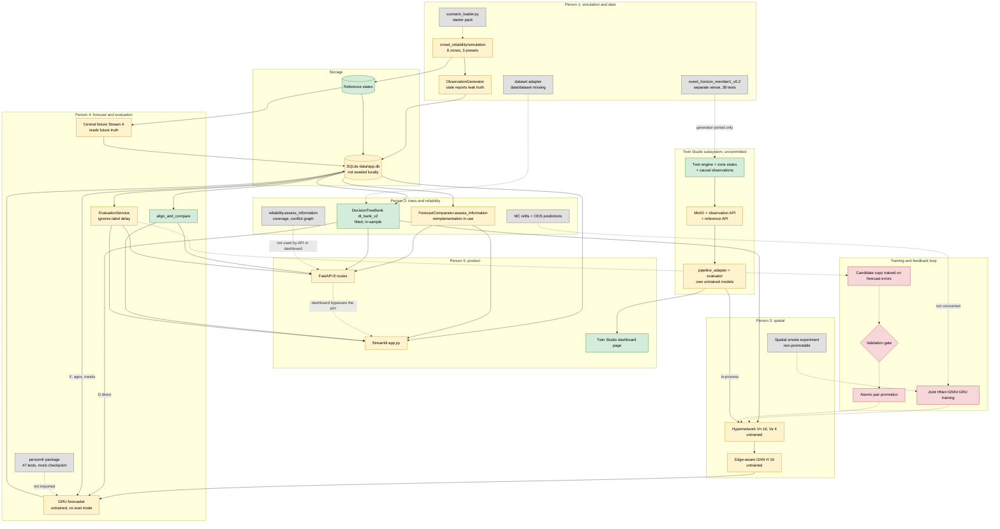

# Implementation status map

**As of:** 15 October 2026, verified against the code, not against the other docs.
**Repository state:** `main` at `08d184d`, plus uncommitted Twin Studio work (see section 7).
**Sources compared:** `docs/ARCHITECTURE.md` v0.1, `Event_Horizon_5_Person_Workload_Plan.pdf`, the code under `crowd_reliability/`, `dashboard/`, `person4/`, `services/twin_studio/`, the external `event_horizon_member1_v0.2/` folder, and the audits under `../audit/`.

## 1. Summary

- **The forward forecast path is built end to end and runs.** Observations flow through the tree bank, hypernetwork, GNN and GRU to Stream B forecasts, which are compared with Stream A and scored.
- **Only the decision-tree bank is trained.** The hypernetwork, GNN and GRU run with untrained initial weights, and the active manifest says so.
- **The training and feedback loop does not exist yet.** There is no joint spatial and temporal training, no candidate copy, no validation gate and no promotion.
- **Several finished modules are not connected to the running app.** These are the canonical reliability engine, the whole `person4/` package, Person 1's v0.2 simulator, the starter-scenario loader and the out-of-sample tree predictions.
- **Some known critical defects are still in the code.** The GRU is never put in eval mode, no readiness gate exists, and the central fixture reads future truth. Section 6 lists them all.
- **The product layer is the thinnest part.** The README is still a template, there is no container for the main app, and the dashboard reads SQLite directly instead of calling the API.

### Test results (run today on a throwaway database)

| Suite | Result |
|---|---|
| `MKCrusaders26/tests` (main + Twin Studio host tests) | 269 passed, 0 failed (after the 15 October test fixes) |
| `MKCrusaders26/person4/tests` | 47 passed |
| `event_horizon_member1_v0.2/tests` | 39 passed |
| `tests/twin_phase4_integration` (live MinIO + network probe) | Not run. It needs Docker, and drive C: is full. |

`models/production` was hash-checked before and after the run and did not change. The main suite now uses its own temporary database through `tests/conftest.py`, so it no longer reads or writes `data/app.db`.

## 2. System map

Legend:
- **Green:** implemented, wired into the runtime path, trained.
- **Amber:** implemented and wired, but untrained or with a known defect.
- **Red:** designed but not implemented.
- **Grey:** implemented but not connected to the runtime path.
- **Dashed arrow:** the connection is missing or only exists in design.

## 3. Status by owner

### Person 1: simulation, data and scenarios

| Item | Implemented | Connected | Notes |
|---|---|---|---|
| Venue with zones and edges | Yes | Yes | `simulation/scenarios.py`: 8 zones, 7 directed connections. Hard-coded in Python, not `data/venue.json`. |
| Seeded simulator | Yes | Yes | `CrowdSimulator`. Used by `seed-demo`, `replay`, tree training and the spatial experiment. |
| Three demo scenarios | Yes | Partly | `crowd_surge`, `bottleneck_exit_closure`, `normal_evacuation`. Only `crowd_surge` gets forecasts and a central fixture in `seed-demo`. |
| Observation generator with observed, published and received times | Yes | Yes | Has defects: stale reports take their value from current truth, and report IDs use `uuid4`, so they are not reproducible from the seed. |
| Separate reference archive | Yes | Yes | Stored in the same SQLite file. Separation is by table and code convention, not by access control. |
| Scenario reset, step and adjustable parameters | No | No | No step or reset endpoint, CLI command or dashboard control. |
| `event_horizon_member1_v0.2` | Yes | No | Standalone and outside git. It has a different venue, 30 seeded runs, and observation/reference access stores. Only its generator logic was ported, into Twin Studio. |
| Starter-pack scenario loader | Yes | No | `simulation/scenario_loader.py` is called from nowhere. |
| Dataset adapter (`dataset-ingest`, `dataset-train`) | Yes | No | `data/dataset/` is missing, so the commands cannot run. Artifacts from an earlier run sit in `models/trees/dataset/`. |

### Person 2: tree models and reliability

| Item | Implemented | Connected | Notes |
|---|---|---|---|
| Six-channel tree bank `dt_bank_v2` with scaler `scaler_obs_only_v1` | Yes | Yes | Fitted by `seed-demo` on all three presets, which is in-sample. Pickled with scikit-learn 1.9.1, while this machine runs 1.7.2. |
| Observed-only feature schema and as-of snapshots | Yes | Yes | `ml/features.py`, `ml/trees.py`. |
| `infer_tree_vector` and the `/tree-outputs` route | Yes | Yes | The API loads `models/trees/tree_bank_dt_bank_v2.joblib`, but the pipeline loads `models/production/tree_bank.joblib`. The two files differ and both are labelled `dt_bank_v2`. |
| `train-trees`, `mc-refit`, `benchmark-trees`, `export-tree-vector` | Yes | CLI only | Three Monte Carlo runs and benchmarks are saved. |
| Out-of-sample tree predictions | Yes | No | `models/trees/mc/oos_predictions.jsonl` exists. No spatial or temporal training reads it. |
| Reliability engine: freshness thresholds, dedupe, conflicts, conflict graph, coverage, five labels | Yes | No | `crowd_reliability/reliability/`. The canonical `assess_information`, `compute_coverage` and `build_conflict_graph` are used only by tests. |
| Assessment actually served | Partly | Yes | `ForecastComparator.assess_information` is a reimplementation. It has no scenario or zone thresholds, uses an age-based stand-in for coverage, and builds no conflict graph. |
| Fixed-expiry freshness baseline | Yes | No | Defined in `reliability/freshness.py` and never evaluated. |
| Missing-data masks in tree output | No | Not applicable | Tree masks encode exit applicability only. A zone with all sensors missing still reports mask 1 on every channel. |

### Person 3: spatial ML

| Item | Implemented | Connected | Notes |
|---|---|---|---|
| Graph builder with reverse message edges | Yes | Yes | `ml/graph.py`. E = 14 for the main venue. |
| Hypernetwork producing Vn[Z,16] and Ve[E,4] ≥ 0 | Yes | Yes | Untrained. All six tree channels and masks reach its input, and tests prove it. |
| Two-layer edge-aware GNN producing H[Z,16] | Yes | Yes | Untrained. |
| `encode_spatial`, `spatial_snapshot`, `spatial_contract` | Yes | Yes | Called by `ArchitecturePipeline.step()`. |
| Versioned pair directory and atomic manifest switch | Yes | Yes | Active pair is `hypernet_v2__gnn_edge_v2__d1018ba3`. `SPATIAL_STATUS.md` still names the older `6675c91e`. |
| `spatial-init` and `export-spatial-sample` | Yes | CLI only | |
| Smoke experiment (graph vs no-graph) | Yes | No | Checkpoints are labelled non-promotable by design. Queue length gets worse with the graph, and that is not yet investigated. |
| Real training with Person 4 | No | No | Blocked until Person 4's GRU and the out-of-sample tree inputs are agreed. |
| Candidate copy, feedback training, validation gate, atomic promotion, rollback | No | No | Only a guard that blocks smoke checkpoints from becoming active exists. |

### Person 4: temporal forecast, comparison and evaluation

| Item | Implemented | Connected | Notes |
|---|---|---|---|
| GRU forecaster with 5 numeric heads and 1 exit head, 3 horizons | Yes | Yes | `ml/temporal.py`. Untrained, and stays in train mode, so dropout makes forecasts non-deterministic. |
| U[z,t] = raw, age, mask, D, H (40 dims) | Yes | Yes | Tree masks and the exit-applicability mask are not in U, although the architecture asks for them. History is fixed at 12 steps. `LOOKBACK_STEPS` in `.env` is ignored. |
| Central fixture (Stream A) | Yes | Yes | `services/central_source.py` blends current truth with the truth at the target time. That leaks future ground truth into Stream A. |
| Stream A/B alignment and signed and absolute differences | Yes | Yes | `services/comparator.py` `align_and_compare`, used by `/api/forecasts` and the dashboard. |
| Reference-based scoring (MAE, RMSE, exit accuracy) | Yes | Yes | `services/evaluator.py`. It ignores `label_available_at`, so it does not model delayed labels. |
| `person4/` package: sequences, masked loss, training, inference, baselines, comparison, delayed-label evaluation | Yes | No | 47 tests pass. Nothing in the app imports it. Its checkpoint is a mock with 39 inputs and 6 zones, which no longer matches its own config of 40 and 8. Its central adapter defaults to the truth-derived CSV. |
| Persistence and moving-average baselines | In `person4/` only | No | The Twin Studio evaluator has its own observation-persistence Stream A. |
| Trained temporal checkpoint and training notebook | No | No | No `.ipynb` exists anywhere in the repo. |

### Person 5: product and release

| Item | Implemented | Connected | Notes |
|---|---|---|---|
| FastAPI app | Yes | Yes | 8 routes, listed in section 5. |
| Streamlit dashboard `dashboard/app.py` | Yes | Partly | Five tabs. It reads SQLite directly instead of calling the API. Ground truth is shown by default. It assesses only the final timestamp. Only `crowd_surge` has forecasts to show. |
| Twin Studio dashboard page | Yes | Yes | Reads evaluator output files and reveals labels only on a button press. |
| Health endpoint | Partly | Yes | Reports only whether the tree bank is loaded. It says nothing about the untrained neural stages. |
| CSV/JSON export | No | No | |
| Local database seeding | Yes | Not run here | `data/app.db` does not exist, so the API and dashboard are empty until `seed-demo` runs. `seed-demo` also rewrites `models/production`. |
| Container for the main app | No | No | The only Dockerfile and Compose file are for Twin Studio services. |
| README | Partly | Not applicable | Still the template with "TO COMPLETE" fields and "not a runnable application", plus an audit section. |
| Round 1 and Round 2 objectives documents, demo script | No | No | |

## 4. Connection matrix

| From | To | State | Evidence |
|---|---|---|---|
| Simulator | SQLite observations and references | Connected | `cli.cmd_seed_demo`, `cmd_replay` |
| SQLite observations | Tree bank | Connected | `pipeline._zone_inputs`, `api.get_tree_outputs` |
| Tree vector D | Hypernetwork | Connected | `spatial.encode_spatial` |
| Hypernetwork | GNN | Connected | `SpatialEncoder.forward_tensors` |
| GNN H and D | GRU | Connected | `pipeline.step` builds U |
| GRU | Forecast records | Connected, but only during `seed-demo` and `replay` | The API serves precomputed rows. It never runs inference itself. |
| Central fixture | Forecast records | Connected | Built from reference truth |
| Forecast records | Comparator, evaluator, API, dashboard | Connected | |
| Reliability package | API, dashboard | **Not connected** | The API and dashboard call the comparator's reimplementation |
| Out-of-sample tree predictions | Spatial or temporal training | **Not connected** | No reader exists |
| `person4/` package | Pipeline, API | **Not connected** | No imports |
| `event_horizon_member1_v0.2` | Main repo | **Not connected** | Outside git. Twin Studio has a port of its generator. |
| Evaluator errors | Candidate training | **Not built** | |
| API | Dashboard | **Not connected** | Dashboard uses `SessionLocal` directly |
| Twin Studio observations | Main pipeline | Connected in-process | `services/twin_studio/pipeline_adapter.py`, with its own untrained models |
| Twin Studio | Main API and main dashboard | **Not connected** | Only the separate dashboard page reads its outputs |

## 5. API routes: plan versus code

| Planned route (workload plan section G) | In code |
|---|---|
| `GET /health` with a model-loaded flag | Present. Covers the tree bank only. |
| `GET /api/scenarios` | Present |
| `POST /api/scenarios/{id}/step` | **Missing** |
| `GET /api/scenarios/{id}/observations?as_of=` | **Missing** |
| `GET /api/scenarios/{id}/assessment?as_of=` | Present as `GET /api/assessments?evaluated_at=`. It uses the reimplementation and raises a `TypeError` on timestamps with a UTC offset, according to the latest audit. |
| `GET /api/scenarios/{id}/tree-outputs?as_of=` | Present. Returns the same response shape on an empty database (fixed 15 October). |
| `GET /api/scenarios/{id}/forecasts?as_of=` | Present as `GET /api/forecasts`, with no `as_of` filter on issue time |
| `GET /api/scenarios/{id}/comparison?as_of=` | Folded into `/api/forecasts` |
| `GET /api/scenarios/{id}/metrics` | Present as `GET /api/metrics`, without label-delay gating |
| Extras not in the plan | `/`, `/api/venue`, `/api/manifest` |

## 6. Known defects still present in the code today

Each item was checked in the source on 15 October, not copied from older docs.

| # | Severity | Defect | Where | Owner |
|---|---|---|---|---|
| 1 | Critical | The untrained neural stack is served as active. No readiness gate checks `training_status`. | `ml/pipeline.py` `load_pipeline` | P3, P4 |
| 2 | Critical | The GRU is never put in eval mode, so identical inputs give different forecasts. Twin Studio works around it locally. | `ml/temporal.py` `load`, `ml/pipeline.py` `step` | P4 |
| 3 | Critical | If an artifact is missing, the pipeline loads silently and the unfitted bank returns heuristic values with mask 1. | `ml/pipeline.py` `load_pipeline`, `ml/tree_bank.py` `predict_zone` | P2, P3 |
| 4 | Critical | The central fixture reads truth at the target time, so Stream A has an unfair advantage and the A/B comparison is not valid. | `services/central_source.py` | P4 |
| 5 | High | Stale generator reports derive their value from current truth under a back-dated timestamp. | `simulation/generator.py` | P1 |
| 6 | High | The API and the pipeline load two different tree-bank files that carry the same version label. | `api._load_tree_bank`, `pipeline.load_pipeline` | P2, P5 |
| 7 | High | The served assessment bypasses the canonical reliability engine. | `services/comparator.py`, `api.py`, `dashboard/app.py` | P2, P5 |
| 8 | High | Tree outputs and forecasts have no missing-data mask, and schemas have no unit column for tree channels. | `ml/tree_bank.py`, `models/schema.py` | P2, P4 |
| 9 | Medium | The evaluator ignores `label_available_at`. | `services/evaluator.py` | P4 |
| 10 | Medium | The dashboard shows ground truth by default. The plan says truth should appear only on an explicit action. | `dashboard/app.py` | P5 |
| 11 | Fixed | `test_api_tree_outputs_route` failed on an empty database. Fixed 15 October: the route now always returns its contract metadata, and tests use an isolated database. | `api.get_tree_outputs`, `tests/conftest.py` | P2 |
| 12 | Low | Report IDs are not reproducible from the seed. | `simulation/generator.py` | P1 |
| 13 | Low | Pickled models come from a newer scikit-learn than the one installed. | `models/production/tree_bank.joblib` | P2 |

The latest alignment audit (`../audit/alignment_rereview_20261014T200223Z/`) adds a broader finding. The repo measures forecast error only, and nothing yet measures whether the reliability labels are right. Its `rapidly_changing` label had 7–21% precision in that audit.

## 7. Twin Studio subsystem (uncommitted)

This is the newest work. It is all untracked or uncommitted on `main`.

| Phase | Content | Status |
|---|---|---|
| 1–3 | 11-zone venue, gate closures in both engines, zone states, causal observations, deterministic run bundles | Done, host-tested |
| 4 | MinIO storage, observation API, reference API with server-side watermark, keyed IDs, Compose | Implemented. **Live verification not run**, because Docker is blocked and C: has about 0.5 GB free. |
| 5 | Adapter into the main pipeline with its own environment directory and untrained models; tree channels masked as unavailable | Done, host-tested |
| 6 | Evaluator: Stream B architecture vs Stream A observation persistence, forecasts persisted before labels, delayed labels | Done in-process |
| 7 | Dashboard reveal page | Done, tested headless |

Points to act on:
- The work changes one main-pipeline file, `crowd_reliability/ml/graph.py`, so that it accepts declared-unknown capacity.
- Venue capacities and camera B coverage are still open decisions for Person 1.
- `models/spatial/` (smoke experiment output) is untracked and not git-ignored.
- The Twin secrets folder is correctly git-ignored.

## 8. What remains to be built, by scope gate

### Gate P0: minimum judgeable product
1. Fix defects 2, 3 and 4 so that forecasts are deterministic, missing artifacts fail loudly, and Stream A no longer reads future truth.
2. Route `/api/assessments` and the dashboard through `reliability.assess_information`, and delete the reimplementation.
3. Make one tree-bank file canonical for both the API and the pipeline.
4. Generate forecasts and a central fixture for all three scenarios, not only `crowd_surge`.
5. Turn the truth reveal off by default.
6. Seed the database on the demo machine and confirm the full flow once.

### Gate P1: substantially functional product
1. Train the GRU together with the hypernetwork and GNN on scenario-split data that uses the out-of-sample tree predictions. Save the checkpoint and record its status in the manifest.
2. Add a readiness gate that labels or refuses untrained stages, and make `/health` report every stage's status.
3. Decide between `crowd_reliability/ml/temporal.py` and `person4/`. Either import `person4` into the pipeline or port its masked loss, baselines and delayed-label evaluation. Then remove the stale mock checkpoint.
4. Add the missing routes: scenario step and reset, observations as-of, forecasts as-of, and CSV/JSON export.
5. Make the dashboard call the API, and add scenario playback controls.
6. Add missing-data masks and tree-channel units to the records.
7. Gate evaluation on `label_available_at`.
8. Add a training and inference notebook.
9. Rewrite the README with real commands and results, and add a container for the main app.
10. Commit the Twin Studio work, then run its live MinIO suite after freeing disk space on C:.

### Gate P2: advanced features
1. Candidate copy of the hypernetwork and GNN trained on forecast-error cases.
2. Validation gate on held-out scenarios.
3. Atomic pair promotion and rollback, with tree and GRU weights frozen during the loop.
4. Feedback-isolation and promotion tests.
5. Investigate the queue-length regression in the spatial model.
6. Evaluate the reliability labels themselves against truth, using the fixed-expiry baseline as the comparison.
7. Decide whether Person 1's v0.2 simulator or Twin Studio replaces the built-in simulator, and wire in the starter-pack loader or remove it.

## 9. Suggested order

1. Make the four Gate P0 correctness fixes first, because every later result depends on them.
2. Agree on one temporal implementation before anyone trains, to avoid training a model that is later discarded.
3. Commit the Twin Studio work so it is not lost and others can review it.
4. Train the neural stages, then build the feedback loop only if time remains.
