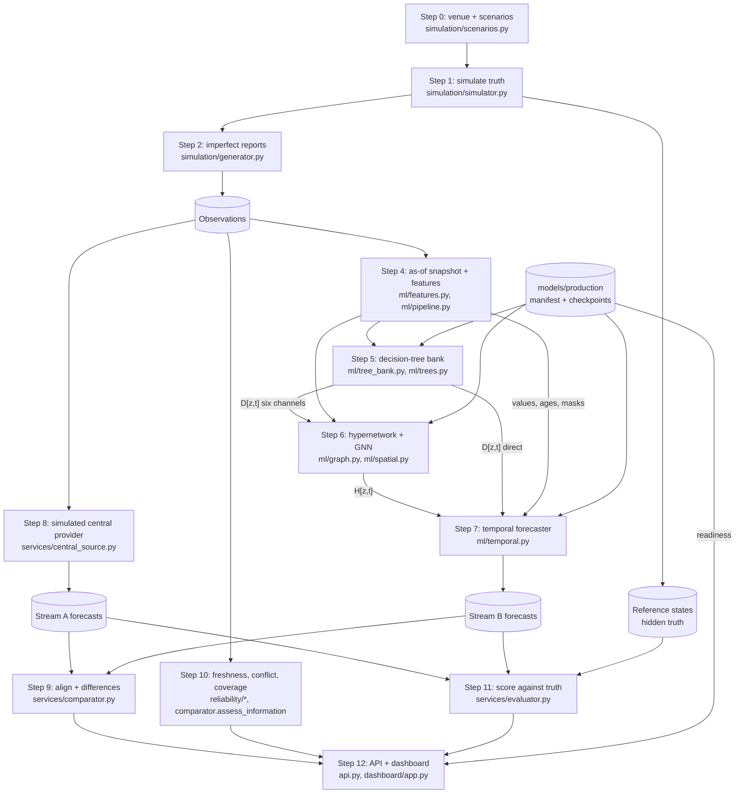
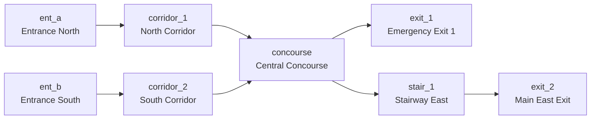
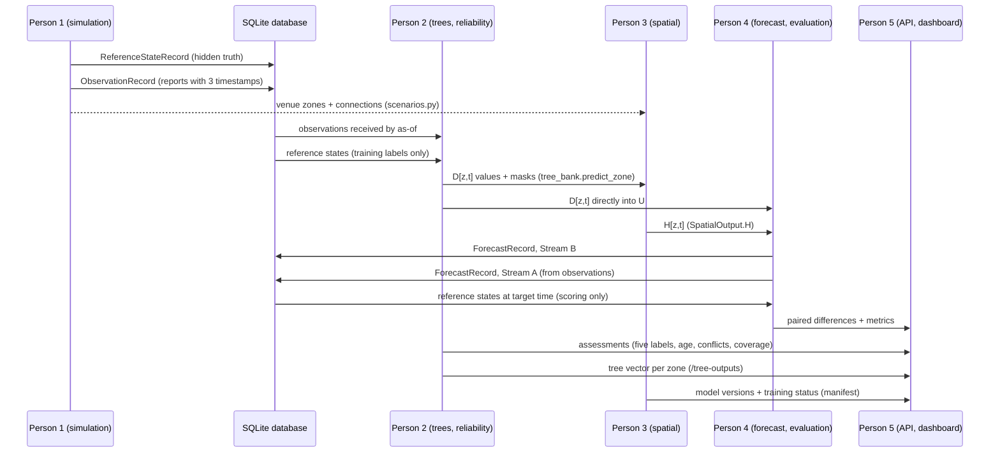

> Historical handoff notes. Current integrated behavior and validation status are recorded in [IMPLEMENTATION_STATUS.md](IMPLEMENTATION_STATUS.md) and [INTEGRATION_AUDIT_RECONCILIATION.md](INTEGRATION_AUDIT_RECONCILIATION.md). Statements below about active versions, untrained stages or incomplete wiring may describe the earlier snapshot.

# Event Horizon: project walkthrough and presenter's guide

**Project:** Crowd Disaster Information Reliability (repository `MKCrusaders26`, Manipal Hackathon 2026, Round 2).
**Sources:** `Event_Horizon_5_Person_Workload_Plan.pdf` (14 October 2026), `docs/ARCHITECTURE.md` v0.1, and the code in this repository as of 15 October 2026.
**Who this is for:** every team member. After reading it you should be able to explain the whole system, defend your own part, and answer questions about anyone else's part.

How to read it:
1. Sections 1 and 2 give the idea and the vocabulary. Read them first.
2. Section 3 walks through the system one step at a time, from the simulator to the dashboard.
3. Sections 4 and 5 show how the files connect.
4. Section 6 explains each person's job, as the plan defines it, and where that job lives in the code.
5. Section 7 traces every handoff: what data passes from one person to the next, in which file, in what shape.
6. Sections 8 to 12 are reference material: numbers, side projects, commands, honest status and likely questions.

---

## 1. The project in one page

### The problem

During a crowd emergency (a surge at the entrances, a blocked exit), the people in charge rely on reports: camera counts, door sensors, steward radio calls. Those reports have three problems:
- **They age.** A report that said "exit 1 is clear" two minutes ago may be wrong now.
- **They conflict.** A camera and a steward can report different things about the same place at the same time.
- **They are incomplete.** Sensors drop out, and some places have no recent report at all.

The plan states the working objective as: *explain how crowd-disaster information is aging, conflicting or insufficient, while showing independently identified architecture and central-source forecasts by variable and horizon.*

### What we built

A system that:
1. **Simulates** a venue during a crowd incident and keeps the true state of every zone hidden as a reference archive.
2. **Generates imperfect reports** from that truth: delayed, noisy, sometimes missing, sometimes stale, sometimes contradictory.
3. **Assesses the information**: how old each report is, whether reports disagree, whether there is enough evidence.
4. **Forecasts** six crowd variables per zone at 30, 60 and 120 seconds ahead, with two independent forecast streams:
   - **Stream A, central source:** what an outside provider would forecast. In our demo this is a simple simulated provider built only from reports, and it is labelled as simulated.
   - **Stream B, architecture:** our own pipeline of decision trees, a graph hypernetwork, a graph neural network and a recurrent forecaster.
5. **Compares** the two streams channel by channel and, once the hidden truth becomes available, **scores** both.
6. **Shows** everything on a dashboard and through a REST API.

### The six variables

Every part of the system works with the same six variables, always kept separate:

| Variable | Meaning | Unit |
|---|---|---|
| density | People per square metre in the zone | p/m² |
| speed | Average walking speed | m/s |
| inflow | People entering per second | p/s |
| outflow | People leaving per second | p/s |
| queue_length | People waiting in a queue | persons |
| exit_open | Whether the exit is open (exits only) | probability 0–1 |

### The eight project rules ("invariants")

The plan says these must survive every merge. They are the backbone of every design decision, so know them by heart.

1. **The tree output is a named six-channel vector**, never averaged or turned into one "trust score".
2. **Missing data and exit applicability are kept as masks.** A missing observation is not a meaningful zero.
3. **The full tree vector enters both** the hypernetwork (as context) and the temporal forecaster (directly, at every time step).
4. **The hypernetwork generates** the 16-number node values and 4-number non-negative edge values that the GNN uses. The GNN must not bypass it.
5. **Stream A and Stream B stay separate.** "Central" does not mean "true".
6. **Predictions, freshness, conflict, coverage and truth are different data products.** Observations and forecasts are never relabelled as each other.
7. **Inference uses only information available at that moment** ("as-of"). The simulator's truth is used only for training and for scoring later.
8. **The feedback loop, if built, only updates a copy** of the hypernetwork and GNN and promotes them together after validation. Trees are refitted separately from Monte Carlo data. The temporal model is not changed by the loop.

---

## 2. Vocabulary you will use

| Term | Meaning in this project |
|---|---|
| Venue | The map: 8 zones connected by 7 one-way walking connections |
| Zone | One area of the venue, for example `concourse` or `exit_1` |
| Scenario | A seeded configuration of one incident, for example `crowd_surge` |
| Reference state | The simulator's true value of one variable in one zone at one instant. Hidden from inference. |
| Observation (report) | An imperfect, timestamped report of one variable in one zone, from one source |
| `observed_at` / `published_at` / `received_at` | When the evidence was captured, sent, and arrived at our system. Always in that order. |
| As-of time | The moment we pretend "now" is. Only reports with `received_at` at or before it may be used. |
| `label_available_at` | When a truth value is allowed to be revealed for scoring |
| Tree vector **D[z,t]** | The six decision-tree estimates of the current state of zone z at time t |
| Masks | 0/1 flags saying whether a value is present, fresh, or applicable |
| **Vn**, **Ve** | Node values (16 per zone) and edge values (4 per connection) generated by the hypernetwork |
| **H** | The GNN's spatial embedding, 16 numbers per zone |
| **U[z,t]** | The 40-number input vector the temporal forecaster receives per zone per time step |
| Horizon | How far ahead a forecast looks: 30, 60 or 120 seconds |
| Stream A / Stream B | Central-source forecast / our architecture's forecast |
| Manifest | `models/production/manifest.json`: which model files are active, their versions, hashes and training status |
| Readiness | Whether every neural stage is trained and validated. Today it is not, so Stream B is served as "experimental". |

---

## 3. The project flow, step by step

### 3.1 The whole flow in one picture



Steps 3 (storage) and 13 (model lifecycle) are not boxes in the picture. Step 3 is the SQLite database that sits between every box. Step 13 is how the files in `models/production` were made.

### Step 0: Define the venue and the scenarios (Person 1)

**File:** `crowd_reliability/simulation/scenarios.py`

The venue has 8 zones and 7 one-way connections:



Each zone has a type (entrance, corridor, assembly, stairway, exit), an area, a capacity and an exit flag. Each connection has a width and a distance.

Three preset scenarios, all 300 seconds long in 5-second steps:

| Scenario | What happens | Report quality |
|---|---|---|
| `crowd_surge` | Arrivals jump to 4× between 45 s and 180 s; no exit closure | 10% dropout, 25% stale, 20% conflicting |
| `bottleneck_exit_closure` | 2× surge from 30 s to 120 s; exit_1 blocked from 70 s to 220 s | 15% dropout, 30% stale, 25% conflicting |
| `normal_evacuation` | Steady flow, everything open | 5% dropout, 10% stale, 5% conflicting |

**Talking point:** "One small, fixed venue and three seeded scenarios. The same seed always produces the same incident, which makes every result reproducible."

### Step 1: Simulate the true state (Person 1)

**File:** `crowd_reliability/simulation/simulator.py`, class `CrowdSimulator`, method `run_simulation(scenario)`

Every 5 simulated seconds, starting at 2026-10-14 12:00:00 UTC:
1. **Arrivals:** 2 people per second, multiplied by the surge factor, split 55% to `ent_a` and 45% to `ent_b`.
2. **Density and speed per zone:** density = people / area. Speed follows a standard pedestrian curve: free speed 1.34 m/s, falling as density rises towards a jam density of 5.2 p/m², never below 0.12 m/s.
3. **Flows along each connection:** width × density × speed, reduced when the destination is near capacity (back-pressure).
4. **Exits:** an open exit discharges about 3.5 people per second and dissolves its queue. A blocked exit discharges only 0.2 per second and arrivals pile up in a queue.
5. **Mass balance:** each zone's count changes by inflow minus outflow.
6. **Output:** one `ReferenceStateRecord` per zone, per variable, per step. For non-exit zones `exit_open` is stored as −1, meaning "not applicable".

**Output:** 8 zones × 6 variables × 60 steps = 2,880 reference records per scenario.

**Rule:** these records are the hidden truth. They are used to train the trees, to score forecasts, and nothing else.

### Step 2: Turn truth into imperfect reports (Person 1)

**File:** `crowd_reliability/simulation/generator.py`, class `ObservationGenerator`, method `generate_observations(ref_records, scenario)`

For every reference record (except non-applicable exit values):
1. **Dropout:** with the scenario's dropout probability, no report is produced.
2. **Source:** one realistic source is chosen per variable, for example `overhead_camera` or `rfid_density_mesh` for density, `steward_radio` or `magnetic_door_status` for exits.
3. **Timing:** `observed_at` is the true instant. `published_at` is 0.5–3 s later, and `received_at` is a further 0.2–1.5 s later.
4. **Noise:** numeric values get about 8% Gaussian noise. Exit status is flipped 5% of the time.
5. **Stale copy** (scenario probability): an extra report, back-dated 45–120 s, with a lower value and a `_delayed` source.
6. **Conflicting report** (scenario probability): an extra report from a second source, such as `manual_warden_patrol`, with a contradictory value (×0.4, ×2.2, or a flipped exit).

**Output:** about 2,700–3,400 `ObservationRecord`s per scenario.

**Known weakness to be ready for:** the stale copies take their value from the current truth, not the truth at their back-dated time. Report IDs use random UUIDs, so they are not reproducible from the seed. Both are listed in `docs/IMPLEMENTATION_STATUS.md`.

### Step 3: Store everything (Person 5, using Person 1's records)

**Files:** `crowd_reliability/models/schema.py` (tables), `crowd_reliability/database.py` (connection), `crowd_reliability/config.py` (settings), `crowd_reliability/cli.py` (commands that fill the database)

The SQLite database (`data/app.db` by default) has one table per record type in the plan's "shared interface freeze":

| Table | Written by | Read by |
|---|---|---|
| `zones`, `connections` | `cli db-init` from the venue | API, dashboard |
| `reference_states` | seeding commands (simulator output) | evaluator, dashboard truth overlay |
| `observations` | seeding commands (generator output) | pipeline, assessment, API, dashboard |
| `tree_outputs` | seeding commands (pipeline output) | stored for export and inspection |
| `forecasts` | seeding commands (both streams) | comparator, evaluator, API, dashboard |
| `assessments` | defined, not yet written | not used yet |
| `model_manifests` | seeding commands | API `/api/manifest`, dashboard |

**The command that fills it for a demo:** `python -m crowd_reliability.cli seed-serving`. It:
1. Loads the committed models read-only and refuses to run if any file is missing or fails its hash.
2. Simulates all three scenarios and generates their reports.
3. Runs Stream B every 5 seconds and Stream A every 15 seconds.
4. Writes everything to the database and checks that nothing in `models/production` changed.

The older `seed-demo` command also retrains the tree bank and rewrites `models/production`. It is for development, not for serving.

### Step 4: Build an as-of snapshot (Persons 1 and 2)

**Files:** `crowd_reliability/ml/features.py` (`build_feature_row`), `crowd_reliability/ml/pipeline.py` (`extract_zone_features_detailed`, `_legacy_zone_features`)

For a given zone and as-of time:
1. Keep only reports with `received_at` ≤ as-of. This is the core leakage guard.
2. For each variable, pick the report with the smallest age (age = as-of − `observed_at`).
3. Produce, per variable:
   - the **value** (a documented default if there is no fresh report),
   - the **age**, normalised to 0–1 over 120 seconds,
   - an **observed mask**: 1 if the selected report is at most 90 seconds old.

**Output:** an 18-number feature row per zone: 6 values, 6 ages, 6 masks, in a fixed order called `obs_only_v1`. The order never changes; a change would need a new schema version.

The spatial path builds a richer 36-feature version of the same snapshot (Step 6), where missing values are carried by a "present" flag instead of a default.

### Step 5: Estimate the current state with decision trees (Person 2)

**Files:** `crowd_reliability/ml/tree_bank.py` (`DecisionTreeBank`), `crowd_reliability/ml/trees.py` (`infer_tree_vector`, the published contract)

The tree bank holds six independent trees, one per channel:

| Channel | Model | Applies to |
|---|---|---|
| `estimated_density` | regression tree, depth 6 | all zones |
| `estimated_speed` | regression tree | all zones |
| `estimated_inflow` | regression tree | all zones |
| `estimated_outflow` | regression tree | all zones |
| `estimated_queue_length` | regression tree | all zones |
| `probability_exit_open` | classification tree (probability) | exit zones only |

1. The 18-number feature row is standardised with the versioned scaler `scaler_obs_only_v1`.
2. Each tree predicts its own channel. Nothing is averaged or combined.
3. The output is **D[z,t]**: six values plus six masks. The exit mask is 0 outside exit zones.

**How the trees were trained:** on the observed feature rows, with labels from the reference state at the same moment. They never see forecasts; `tree_train.py` raises an error if forecasts are passed in.

**Talking point:** "The trees answer 'what is the situation right now, given these imperfect reports?' and they keep six separate answers."

### Step 6: Add spatial context with the hypernetwork and GNN (Person 3)

**Files:** `crowd_reliability/ml/graph.py` (`SpatialGraphBuilder`, `GraphHyperNetwork`, `EdgeAwareGNNLayer`, `SpatialGNN`), `crowd_reliability/ml/spatial.py` (`SpatialEncoder.encode_spatial`, the 36-feature schema, checkpoint handling)

1. **Graph:** each of the 7 connections becomes a forward edge plus a reverse "message" copy, so there are 14 edges. The reverse copies let information about, say, a blocked exit flow back to the concourse. They do not mean people can walk backwards.
2. **Static descriptors:**
   - per zone, 8 numbers: a zone-type one-hot (5), capacity, area and exit flag;
   - per edge, 4 numbers: width, distance, "is reverse copy" and "is walkable".
3. **Dynamic context per zone, 36 numbers:** for each of the 6 variables, the value, age, "report present" flag and "fresh" flag (24), plus the full tree vector D (6) and its masks (6).
4. **Hypernetwork** (a small neural network): reads the static and dynamic inputs and *generates*:
   - **Vn**: 16 node values per zone,
   - **Ve**: 4 edge values per edge, forced non-negative with a softplus. Each edge's values depend on the current state of both zones it joins.
5. **GNN:** two message-passing layers over Vn and Ve. Each edge sends a message built from its source zone and its generated edge values. The output is **H**: 16 numbers per zone.

**Output:** `SpatialOutput` with H [8 × 16], Vn [8 × 16], Ve [14 × 4], plus zone and edge ID order and version metadata.

**Status:** the hypernetwork and GNN run with **untrained initial weights**. A separate smoke experiment (`ml/spatial_train.py`) showed the stack can learn and that message passing helps density, speed and flows but not queue length. That experiment's checkpoints are blocked from production by design.

### Step 7: Forecast the future with the temporal model (Person 4)

**Files:** `crowd_reliability/ml/pipeline.py` (`ArchitecturePipeline.step`), `crowd_reliability/ml/temporal.py` (`MultivariateTemporalForecaster`)

1. **Assemble U[z,t]**, 40 numbers per zone: raw values (6), ages (6), observed masks (6), tree vector D (6) and spatial embedding H (16). This is where rule 3 is enforced: D goes directly into the forecaster even though it also went into the hypernetwork.
2. **History:** keep the last 12 steps of U per zone (60 seconds at 5-second steps). Short histories are padded by repeating the first step.
3. **GRU forecaster:** a 2-layer recurrent network with 64 hidden units reads the history. For each horizon it has:
   - a numeric head with 5 outputs (density, speed, inflow, outflow, queue), clamped to be non-negative,
   - an exit head with 1 output, a probability between 0 and 1.
4. **Output tensor:** [8 zones × 3 horizons × 6 variables].
5. **Records:** one `ForecastRecord` per zone, horizon and variable, with `stream_id = stream_b_architecture`, `issued_at`, `target_at = issued_at + horizon`, unit and model version. `exit_open` forecasts are made only for exit zones.

**Status:** the GRU is untrained. It always runs in inference mode, so the same inputs give the same forecasts; a regression test guards this.

### Step 8: Produce the central-source forecast, Stream A (Person 4)

**File:** `crowd_reliability/services/central_source.py`, class `CentralSourceAdapter`, method `generate_simulated_forecasts`

There is no real central provider, so the demo uses a clearly labelled simulated one (`simulated_central_obs_ewma_v2`):
1. Every 15 seconds it issues forecasts.
2. For each zone and variable it looks only at reports received by then and observed in the last 90 seconds.
3. Numeric variables: an exponentially smoothed level of those reports. Exit status: the latest report.
4. That level is used for all three horizons. Forecasts "arrive" 2 seconds after issue.
5. If there is no recent report, it issues **no** forecast. That variable is "unavailable", never invented.

It never reads the reference states. An earlier version did, which made Stream A unrealistically good; that was fixed on 15 October.

The replay file `data/demo/central_forecast.csv` contains these forecasts for all three scenarios.

### Step 9: Compare the two streams (Person 4)

**File:** `crowd_reliability/services/comparator.py`, method `ForecastComparator.align_and_compare`

1. Optionally keep only forecasts received by the as-of time.
2. Match Stream A and Stream B by zone, variable and target time (rounded to 5 seconds).
3. For every match, compute a **signed difference** (architecture − central) and an **absolute difference**, in that variable's unit.
4. Unmatched entries are kept with the other side empty, so "unavailable" stays visible.

**Rule:** a disagreement triggers a review indication. It never says which stream is right.

### Step 10: Assess the information (Person 2)

**Files:** `crowd_reliability/reliability/` (`freshness.py`, `thresholds.py`, `conflicts.py`, `coverage.py`, `assess.py`); the served version is `ForecastComparator.assess_information` in `services/comparator.py`

For one zone and variable at an as-of time:
1. **Collapse copies:** forwarded duplicates of the same claim count once (`deduplicate_reports`).
2. **Age:** the age of the newest independent report.
3. **Conflict:** among reports from the last 30 seconds, flag disagreement when a value deviates from the mean by more than 40%.
4. **Rapid change:** at least 3 reports in the last 60 seconds with a relative spread above 25%.
5. **Per-variable freshness thresholds**, because event-like variables go stale faster:

| Variable | "Recently verified" up to | "Potentially outdated" after |
|---|---|---|
| exit_open | 5 s | 15 s |
| inflow, outflow | 6 s | 25 s |
| speed | 10 s | 35 s |
| queue_length | 15 s | 40 s |
| density | 20 s | 45 s |

6. **Five independent labels**, more than one of which can be true at once: `recently_verified`, `potentially_outdated`, `conflicting_evidence`, `rapidly_changing`, `insufficient_current_evidence` (nothing within 90 s).

**Rule:** an old report is "potentially outdated, needs verification". It is never declared false because of its age.

**Important nuance:** the full engine in `reliability/assess.py` also supports scenario and zone-type threshold multipliers, a proper coverage calculation and a conflict provenance graph. The API and dashboard currently call the simpler version in `comparator.py`. Wiring the full engine in is an open task.

### Step 11: Score against the truth (Person 4)

**File:** `crowd_reliability/services/evaluator.py`, method `EvaluationService.score_predictions`

1. For each forecast, find the reference value at its target time (rounded to 5 seconds).
2. Assign it to the nearest horizon (within 10 seconds).
3. Skip non-applicable exit values.
4. Per stream, horizon and variable, compute MAE, RMSE and count. For `exit_open`, also accuracy and Brier score.

**Open item:** the evaluator does not yet wait for `label_available_at`, and the simulator sets it equal to the state time. The Twin Studio evaluator (Section 9) does model delayed labels properly.

### Step 12: Serve it (Person 5)

**Files:** `crowd_reliability/api.py` (FastAPI), `dashboard/app.py` (Streamlit)

API routes:

| Route | Returns | Built from |
|---|---|---|
| `GET /health` | service status, tree bank loaded, readiness of every neural stage | manifest, tree bank |
| `GET /api/scenarios` | the three scenarios | `scenarios.py` |
| `GET /api/venue` | zones and connections | database |
| `GET /api/manifest` | active versions, hashes, training status, readiness | database + manifest file |
| `GET /api/forecasts?scenario_id=…` | paired Stream A/B forecasts with differences, plus a Stream B readiness label | comparator |
| `GET /api/assessments?scenario_id=…&evaluated_at=…` | the five labels, age, conflicts, coverage per zone and variable | `assess_information` |
| `GET /api/metrics?scenario_id=…` | MAE/RMSE per stream, horizon and variable | evaluator |
| `GET /api/scenarios/{id}/tree-outputs?as_of=…` | the six-channel tree vector per zone | tree bank |

Dashboard tabs: dual-stream forecast, evidence and conflicts, venue graph, model evaluation, pipeline manifest. It shows an "Experimental Stream B" warning while the neural stages are untrained. The "Seed Demo Data Now" button runs `seed-serving`.

**Readiness rule:** `REQUIRE_VALIDATED_MODELS=true` makes the API refuse Stream B forecasts until every neural stage is trained and validated.

### Step 13: How the models are made and kept (Persons 2, 3, 4)

**Files:** `ml/tree_train.py`, `ml/spatial_train.py`, `models/manifest.py`, `ml/pipeline.py` (`save_pipeline`, `load_pipeline`), `cli.py`

| Path | Command | What it does | Status |
|---|---|---|---|
| Tree training | `train-trees`, `seed-demo` | Fit scaler + six trees on reference labels | Done; production bank fitted |
| Monte Carlo tree refits | `mc-refit`, `benchmark-trees` | Re-simulate scenarios with new seeds, refit, predict on a held-out scenario | Done; 3 runs + out-of-sample predictions saved |
| New spatial pair | `spatial-init` | Create a fresh, untrained hypernetwork+GNN pair and switch the manifest atomically, with a backup | Done |
| Spatial smoke experiment | `python -m crowd_reliability.ml.spatial_train` | Test whether the spatial stack can learn | Done; not promotable |
| Joint spatial + temporal training | none | Train H and the GRU together on held-out scenarios | **Not built** |
| Feedback loop | none | Train a copy of HNet+GNN on forecast errors, validate, promote together | **Not built** |

**Loading rules:** `load_pipeline` requires the manifest, the tree bank, the spatial pair and the temporal model, and checks each file's SHA-256 hash against the manifest. Tree and scaler versions must match the manifest. An unfitted tree bank can be neither saved nor served.

---

## 4. File map

```text
MKCrusaders26/
├── crowd_reliability/                  the application package
│   ├── config.py                       settings from environment / .env           P5
│   ├── database.py                     SQLite engine and sessions                 P5
│   ├── models/
│   │   ├── schema.py                   the 8 database tables (shared contract)    all, frozen
│   │   └── manifest.py                 model manifest + readiness assessment      P3 (+P5)
│   ├── simulation/
│   │   ├── scenarios.py                venue + 3 scenario presets                 P1
│   │   ├── simulator.py                true crowd dynamics -> reference states    P1
│   │   ├── generator.py                imperfect reports -> observations          P1
│   │   └── scenario_loader.py          starter-pack scenario adapter (unused)     P1
│   ├── dataset/
│   │   ├── adapter.py, zones.py        external dataset ingestion (data absent)   P1/P2
│   ├── ml/
│   │   ├── features.py                 18-feature as-of row + versioned scaler    P2
│   │   ├── tree_bank.py                six-tree bank, channel metadata            P2
│   │   ├── trees.py                    infer_tree_vector contract                 P2
│   │   ├── tree_train.py               training, Monte Carlo refits, benchmarks   P2
│   │   ├── graph.py                    graph builder, hypernetwork, GNN           P3
│   │   ├── spatial.py                  36-feature schema, encode_spatial          P3
│   │   ├── spatial_train.py            spatial smoke experiment                   P3
│   │   ├── temporal.py                 GRU forecaster                             P4
│   │   └── pipeline.py                 orchestrates trees -> spatial -> GRU       P3/P4 (+P5)
│   ├── reliability/                    freshness, thresholds, conflicts,          P2
│   │                                   coverage, assess
│   ├── services/
│   │   ├── central_source.py           Stream A simulated provider                P4
│   │   ├── comparator.py               A/B alignment + served assessment          P4 (+P2)
│   │   └── evaluator.py                scoring against reference states           P4
│   ├── api.py                          FastAPI routes                             P5
│   └── cli.py                          every command (seed, train, export...)     P5 + owners
├── dashboard/app.py                    Streamlit evaluator dashboard              P5
├── models/
│   ├── production/                     ACTIVE artifacts: manifest, tree bank,     P2/P3/P4
│   │                                   spatial pair, temporal model
│   ├── trees/                          tree training + Monte Carlo artifacts      P2
│   └── spatial/                        smoke-experiment outputs (untracked)       P3
├── data/demo/                          central replay CSV, sample exports         P1/P2/P3/P4
├── person4/                            standalone temporal package (not wired)    P4
├── services/twin_studio/               Twin Studio subsystem (uncommitted)        P1 domain
├── tests/                              main test suite                            all
├── Dockerfile, deploy/hf_space/,       Hugging Face Space deployment              P5
│   .github/workflows/
└── docs/                               architecture, status, this guide           all
```

P1 to P5 are the plan's roles. The plan's suggested paths (for example `src/ml/trees*`) were adapted to this repository's `crowd_reliability/` package, as the plan allows.

---

## 5. How the files are interconnected

### 5.1 Who calls whom

```mermaid
flowchart TD
    cli["cli.py"] --> sim["simulation/simulator.py"]
    cli --> gen["simulation/generator.py"]
    cli --> pipe["ml/pipeline.py"]
    cli --> cent["services/central_source.py"]
    cli --> evals["services/evaluator.py"]
    cli --> ttrain["ml/tree_train.py"]
    sim --> scen["simulation/scenarios.py"]
    gen --> scen
    pipe --> tb["ml/tree_bank.py"]
    pipe --> spat["ml/spatial.py"]
    pipe --> temp["ml/temporal.py"]
    pipe --> man["models/manifest.py"]
    spat --> graph["ml/graph.py"]
    ttrain --> feat["ml/features.py"]
    ttrain --> tb
    trees["ml/trees.py"] --> feat
    trees --> tb
    cmp["services/comparator.py"] --> rel["reliability/*"]
    api["api.py"] --> pipe
    api --> trees
    api --> cmp
    api --> evals
    api --> man
    dash["dashboard/app.py"] --> cmp
    dash --> evals
    dash --> pipe
    dash --> cli
    sim -.-> schema["models/schema.py"]
    gen -.-> schema
    pipe -.-> schema
    cent -.-> schema
    api -.-> db["database.py"]
    dash -.-> db
    cli -.-> db
```

Dotted arrows mean "uses the shared record definitions or the database". Every module that creates or reads records depends on `models/schema.py`, which is why the plan freezes it first.

### 5.2 What each file changes if you change it

| If you change… | You affect… | Why |
|---|---|---|
| `scenarios.py` (venue) | graph shapes, tree exit masks, hypernetwork static inputs, every checkpoint | Zone count, order and types are baked into the spatial checkpoint; loading checks them |
| `simulator.py` | reference labels, so tree training and all scores | Truth changes |
| `generator.py` | every model input, the assessment labels, Stream A | All of them read observations |
| `features.py` (`obs_only_v1`) | the scaler and the tree bank | The trees expect exactly 18 features in this order |
| `tree_bank.py` channels | hypernetwork input (36 features), U (40), the API, every record | D appears everywhere downstream |
| `graph.py` / `spatial.py` dimensions | `temporal.py` input size (40 = 24 + H) | The GRU's input width includes H |
| `temporal.py` heads or horizons | forecast records, comparator, evaluator | Records are per horizon and variable |
| `central_source.py` | Stream A rows, comparison, metrics | |
| `schema.py` | everything | It is the shared contract; change `schema_version` and announce it |
| `models/production/*` | everything served | The manifest's hashes guard each file; a mismatch stops loading |

### 5.3 The shape of the data at every hop

| Hop | Shape |
|---|---|
| Venue | 8 zones, 7 connections (14 message edges) |
| Simulator output per scenario | 60 steps × 8 zones × 6 variables = 2,880 reference records |
| Generator output per scenario | about 2,700–3,400 observations |
| Tree feature row | 18 per zone |
| Tree vector D | [8 × 6] values + [8 × 6] masks |
| Hypernetwork dynamic input | [8 × 36] |
| Hypernetwork static input | node [8 × 8], edge [14 × 4] |
| Vn / Ve | [8 × 16] / [14 × 4], Ve ≥ 0 |
| H | [8 × 16] |
| U per step | [8 × 40] |
| GRU input | [8 zones × 12 steps × 40] |
| GRU output | [8 zones × 3 horizons × 6 variables] |
| Stream B per issue time | 8 × 3 × 5 numeric + 2 exits × 3 horizons = 126 forecast records |

---

## 6. The five people: jobs, files and status

The plan's effort split: Person 1 19%, Person 2 20%, Person 3 22%, Person 4 20%, Person 5 19%. Every person owns tests and documentation for their own module. Priorities are P0 (essential), P1 (by Round 2 deployment) and P2 (stretch).

### Person 1: Simulation, Data and Scenario Engineer

**Mission (from the plan):** supply an identical, replayable zone graph, observation stream and separate reference-label archive to every downstream component.

**Tasks in the plan:**
- **P0:**
  - one manageable venue with stable zones and edges;
  - a seeded simulator producing all six variables per zone;
  - three labelled scenarios (normal, surge, exit restriction);
  - an observation generator with observed, published and received times and distinct source and report IDs;
  - normalised units, original reports kept;
  - reference states exported separately with `label_available_at`;
  - early sample fixtures for everyone else.
- **P1:** scenario reset, step and replay controls with adjustable parameters.
- **P2:** extra layouts and held-out venues; an optional footage pipeline.

**Interface promised:** `get_scenario(id)`, `advance_scenario(id, steps)`, `get_observation_snapshot(id, as_of)`, and reference labels only through a training/evaluation path.

**Acceptance:** a fixed seed reproduces exactly; observation time is never replaced by receipt time; a late or dropped report produces age and mask fields; no truth leaks into a serving snapshot.

**Where it lives:** `simulation/scenarios.py`, `simulation/simulator.py`, `simulation/generator.py`. The fuller external version is `event_horizon_member1_v0.2/` next to the repository, and the Twin Studio subsystem is in the same domain (Section 9).

**Status:**

| Item | State |
|---|---|
| Venue, simulator, 3 scenarios, generator, separate reference records | Done and used |
| As-of snapshots | Done, implemented on the consumer side (`features.py`, `pipeline.py`) |
| Scenario step/reset controls and API | Not built |
| `label_available_at` delay | Set equal to state time; no delay modelled in the main repo |
| Stale-report value and reproducible report IDs | Known defects |
| v0.2 simulator with proper access stores and 39 tests | Built, not wired into the main repo |

**What Person 1 presents:** the venue and seeds, the three scenarios, how reports are delayed, dropped, made stale and contradicted, and that the truth archive is kept separate.

### Person 2: Tree Models and Reliability Engineer

**Mission:** produce the complete named current-state tree vector and defensible freshness and conflict output.

**Tasks in the plan:**
- **P0, trees:**
  - repeatable Monte Carlo datasets with stored seeds and scenario splits;
  - as-of snapshot preparation and unit/invalid-field handling;
  - a fixed feature order with versioned scalers;
  - six separately identifiable channels trained only on reference current state;
  - D[z,t] with names, units, masks and versions;
  - a deterministic inference interface published before optimising.
- **P0, reliability:**
  - observation age, disagreement checks and evidence coverage as separate fields;
  - the five labels, where several may apply and old never means false.
- **P1:**
  - seeded Monte Carlo refits from Person 1's data only;
  - out-of-sample tree predictions for neural training;
  - per-channel benchmarks;
  - duplicate handling, so forwarded copies are not independent confirmations;
  - a fixed-expiry freshness baseline.
- **P2:** scenario-dependent explainable thresholds and a conflict provenance graph.

**Interface promised:** `infer_tree_vector(snapshot) -> values[Z,6], masks[Z,6], channel_metadata` and `assess_information(reports, as_of) -> freshness, conflicts, coverage, flags`.

**Acceptance:** changing one channel's input changes only that channel; all six survive serialisation; masks round-trip; a stale report is flagged but never called false; tree refits read only Monte Carlo observations and current-state labels.

**Where it lives:** `ml/features.py`, `ml/tree_bank.py`, `ml/trees.py`, `ml/tree_train.py`, `reliability/*`, `models/trees/`, `data/demo/tree_vector_sample.json`.

**Status:**

| Item | State |
|---|---|
| Six-channel bank, scaler, `infer_tree_vector`, `/tree-outputs` route | Done and used |
| Monte Carlo refits, out-of-sample predictions, benchmarks | Done; out-of-sample predictions not yet consumed by neural training |
| Five labels, dedupe, per-variable thresholds | Done and served through the comparator version |
| Scenario/zone multipliers, coverage, conflict graph (P2) | Done in the library; not yet wired to the API |
| Fixed-expiry baseline | Defined, not yet evaluated |
| Missing-data masks in tree output | Not built; masks currently mean applicability only |

**What Person 2 presents:** the six channels and why they are never merged, how the five labels are derived with a stale-but-not-false example, and what the Monte Carlo refits are for.

### Person 3: Spatial ML Engineer

**Mission:** turn connected zone geometry plus the unreduced tree vector into trainable spatial embeddings.

**Tasks in the plan:**
- **P0:**
  - an observed graph builder with directed connectivity and as-of contexts;
  - agree D with Person 2 and the embedding size with Person 4;
  - a small hypernetwork generating Vn[Z,16] and non-negative Ve[E,4] from static descriptors, observations, ages, masks and the full D;
  - a two-layer edge-aware GNN producing H;
  - export generated values for inspection;
  - checkpoints with configuration and feature-order metadata, with untrained weights labelled as untrained.
- **P1:**
  - joint training with Person 4 on time-ordered data using Person 2's out-of-sample tree outputs;
  - training scripts, seeds, loss history and trained artifacts;
  - ablation and sanity tests;
  - a manifest tracking every version.
- **P2:**
  - candidate training from labelled replay;
  - a frozen production copy;
  - validation on held-out scenarios;
  - atomic promotion and rollback of the pair.

**Interface promised:** `encode_spatial(snapshot, tree_vector, graph) -> H[Z,H_dim], Vn[Z,16], Ve[E,4], version_metadata`.

**Acceptance:** all six tree channels influence the node generator; Ve ≥ 0; dimensions match; no reference truth at inference; the checkpoint loads in deployment; promotion swaps the pair together only.

**Where it lives:** `ml/graph.py`, `ml/spatial.py`, `ml/spatial_train.py`, `models/manifest.py`, `models/production/spatial/<pair>/`, `models/spatial/experiments/`, `data/demo/spatial_output_sample.json`, `docs/SPATIAL_STATUS.md`.

**Status:**

| Item | State |
|---|---|
| Graph builder with reverse message edges, hypernetwork, GNN, `encode_spatial`, `spatial_snapshot` | Done, tested, wired into every forecast |
| Versioned pair directory, atomic manifest switch, `spatial-init` | Done |
| Smoke experiment (graph vs no-graph) | Done; graph helps four variables, not queue length |
| Trained production weights | Not yet; `untrained_initial` |
| Joint training, feedback loop, promotion | Not built |

**What Person 3 presents:** the graph and why reverse edges exist, how the hypernetwork generates node and edge values from the full tree vector, the smoke experiment's findings, and honestly that production weights are untrained.

### Person 4: Temporal Forecast, Comparison and Evaluation Engineer

**Mission:** turn historical observations, tree vectors and graph embeddings into target-labelled forecasts, then compare them fairly with central predictions and reference outcomes.

**Tasks in the plan:**
- **P0:**
  - a fixed U = concat(X, D, H, age, masks) with D passed directly;
  - rolling windows that reject out-of-order steps (5 s steps, 60 s history, 30/60/120 s horizons);
  - six heads returning [Z, horizons, 6] with names, units, times and versions;
  - a Stream A adapter that never uses truth under a "central" label;
  - alignment on zone, variable, unit and target time, with "unavailable" for missing channels;
  - signed and absolute differences, never a merged trust probability.
- **P1:**
  - joint training with Person 3 and a real trained checkpoint;
  - forecasts persisted before labels arrive, then MAE/RMSE per variable and horizon;
  - persistence and moving-average baselines;
  - evaluation artifacts;
  - tests for unavailable variables, mixed timestamps, unit mismatches and label delay.
- **P2:** uncertainty estimates, scenario-group dashboards, ablations.

**Interface promised:** `forecast(history) -> ForecastRecords`, `compare_architecture_to_central(forecasts, central) -> paired differences`, `score_when_reference_available(forecasts, labels) -> metrics`.

**Acceptance:** forecasts resolved by zone, target time, horizon and variable; the direct tree route kept; no future inputs; the model artifact actually used by the API; comparisons in matching units.

**Where it lives:**
- **Wired into the app:** `ml/temporal.py`, the U assembly in `ml/pipeline.py`, `services/central_source.py`, `services/comparator.py` (`align_and_compare`), `services/evaluator.py`.
- **Standalone package:** `person4/` (`sequence.py`, `model.py`, `train.py`, `inference.py`, `baseline.py`, `central_adapter.py`, `comparison.py`, `evaluation.py`).

**Status:**

| Item | State |
|---|---|
| GRU with six heads, U assembly with direct D, Stream A, alignment and differences, scoring | Done and used |
| Deterministic inference; Stream A no longer reads truth | Fixed 15 October |
| `person4/` package: masked loss, baselines, delayed-label evaluation, 47 tests | Built, not imported by the app; its saved model is a mock |
| Trained temporal checkpoint and notebook | Not built |
| Label-delay gating in the main evaluator | Not built |

**What Person 4 presents:** the 40-number input and why D enters twice, the three horizons, how the two streams are matched and differenced, and how scores are computed only against truth at the target time.

### Person 5: Full-Stack Product and Release Engineer

**Mission:** deliver one usable evaluator-facing product, connect everyone's modules, and meet repository, deployment and demo rules.

**Tasks in the plan:**
- **P0:**
  - freeze API naming and the top-level orchestrator;
  - a dashboard with venue, zones, scenario controls, observation age, conflicts, coverage and unknown states;
  - two independently styled streams with times, curves and differences;
  - clear separation of reports, predictions and hidden truth, with truth revealed only on an explicit action;
  - typed connections to everyone's real modules, never hardcoded answers;
  - a health endpoint, safe errors and CSV/JSON export;
  - a deployment the judges can reach;
  - the Round 1 and Round 2 objectives documents.
- **P1:**
  - at least five real endpoints;
  - the trained model in the repository is the one the API loads;
  - a complete README;
  - a no-secret `.env.example`;
  - a clean-install test with a teammate;
  - a 3–5 minute demo;
  - branch workflow.
- **P2:** rich playback, heatmap animation and accessibility polish.

**Acceptance:** a fresh evaluator can run and test unaided, see scenario-dependent changes, distinguish the two streams, trigger an end-to-end workflow and understand what was trained versus only designed.

**Where it lives:** `api.py`, `dashboard/app.py`, `cli.py` (seeding), `config.py`, `database.py`, `.env.example`, `Dockerfile`, `deploy/hf_space/`, `.github/workflows/deploy-hf-space.yml`, `README.md`.

**Status:**

| Item | State |
|---|---|
| 8 working API routes, dashboard with 5 tabs, health with readiness, `seed-serving` | Done |
| Readiness warning and strict mode | Done 15 October |
| Docker image, Hugging Face Space files, CI workflow | Written; first real build pending |
| Dashboard calls the database directly instead of the API | Open |
| Scenario step/reset controls, CSV/JSON export | Not built |
| Truth shown by default (plan says explicit reveal) | Open |
| README still the template; objectives documents and demo script | Not done |

**What Person 5 presents:** the user problem, the end-to-end dashboard walkthrough, how to run and deploy it, and the honest limitations.

---

## 7. Handoffs: what passes from one person to the next

### 7.1 The handoff chain in order



### 7.2 Every handoff in detail

| # | From → to | What is passed | Exact form | File / function | Key rule |
|---|---|---|---|---|---|
| 1 | P1 → everyone | Venue: zone IDs, types, areas, capacities, exit flags, connections with widths and distances | `VenueLayout` | `scenarios.get_default_venue()` | Stable zone IDs; the order is baked into checkpoints |
| 2 | P1 → database | Hidden truth | `ReferenceStateRecord`: scenario, zone, variable, value, unit, `state_at`, `label_available_at` | `simulator.run_simulation()` | Never read at inference |
| 3 | P1 → database | Reports | `ObservationRecord`: report and source IDs, scenario, zone, variable, value, unit, `observed_at`, `published_at`, `received_at` | `generator.generate_observations()` | Observation time is never replaced by receipt time |
| 4 | P1 → P2 | As-of evidence | List of observations with `received_at` ≤ as-of | `features.build_feature_row()`, `pipeline.extract_zone_features_detailed()` | No future reports |
| 5 | P1 → P2 (training only) | Labels | Reference states matched to each feature row by scenario, zone and 5-second time | `tree_train.build_training_set()` | Forecasts rejected with `LeakageError` |
| 6 | P2 → P3 | Tree vector | `tree_values` [8 × 6] + `tree_masks` [8 × 6], channel order `TREE_CHANNELS` | `tree_bank.predict_zone()` via `pipeline._zone_inputs()` → `spatial.encode_spatial()` | All six channels, unreduced |
| 7 | P2 → P4 | Tree vector, direct path | The same six values, inside U at positions 18–23 | `pipeline.step()` | Rule 3: D enters the forecaster directly |
| 8 | P2 → P3, P4 (training) | Out-of-sample tree predictions | JSON lines per scenario, zone and time | `models/trees/mc/oos_predictions.jsonl` | **Not yet consumed** |
| 9 | P3 → P4 | Spatial embedding | `SpatialOutput.H` [8 × 16], with `zone_ids` order and version metadata | `spatial.encode_spatial()` → `pipeline.step()` | H size read from the checkpoint (16) |
| 10 | P3 → P5 | Model versions and status | Manifest: versions, hashes, `training_status`, `spatial_artifact_dir` | `models/production/manifest.json`, `assess_readiness()` | Untrained must be labelled untrained |
| 11 | P4 → database | Stream B | `ForecastRecord` with `stream_id = stream_b_architecture` | `pipeline.step()` (called by `cli.cmd_seed_serving`) | Persisted at issue time |
| 12 | P1 → P4 | Evidence for Stream A | Observations only | `central_source.generate_simulated_forecasts()` | Never reads reference states |
| 13 | P4 → database | Stream A | `ForecastRecord` with `stream_id = stream_a_central` | same | Labelled "simulated central" |
| 14 | P4 → P5 | Comparison | `ComparisonResult`: zone, variable, unit, target time, both forecasts, signed and absolute difference | `comparator.align_and_compare()` → `/api/forecasts` | No merged trust score |
| 15 | P1 → P4 (scoring) | Truth at target time | Reference states | `evaluator.score_predictions()` | Only for scoring |
| 16 | P4 → P5 | Metrics | MAE, RMSE, count (+ accuracy, Brier for exits) per stream, horizon and variable | `evaluator.score_predictions()` → `/api/metrics` | Reported per variable and horizon |
| 17 | P2 → P5 | Assessments | Age, conflict IDs, coverage, five labels per zone and variable | `comparator.assess_information()` → `/api/assessments` | Old means "needs verification", never false |
| 18 | P2 → P5 | Tree vector for display | Per-zone channel names, units, values, masks, versions | `trees.infer_tree_vector()` → `/api/scenarios/{id}/tree-outputs` | Same verified bank as the pipeline |

### 7.3 One forecast's journey, end to end

Use this as the narrative in the demo. Take `bottleneck_exit_closure`, zone `concourse`, as-of 12:02:30 (150 seconds in).

1. **Person 1's simulator** has exit_1 blocked since 70 s, so people back up towards it. The true concourse density at each step is in the reference archive.
2. **Person 1's generator** has produced camera and RFID reports for the concourse. Some arrived late, one is a stale copy from a minute earlier, and a warden's report contradicts the camera.
3. **The as-of filter** keeps only reports received by 12:02:30. The newest density report is a few seconds old, so its observed mask is 1.
4. **Person 2's trees** turn the 18-number feature row into six estimates: density, speed, inflows, outflows, queue, and exit probability, which is masked to 0 because the concourse is not an exit.
5. **Person 2's assessment** labels the concourse density evidence. If the camera and the warden disagree by more than 40% within 30 seconds, it is "conflicting evidence". If recent values spread widely, it is also "rapidly changing". Neither label says which report is wrong.
6. **Person 3's hypernetwork** reads the concourse's 36-number context, including all six tree estimates, and generates its node values. Edge values for the concourse → exit_1 connection depend on both zones' current state.
7. **Person 3's GNN** passes messages along the 14 edges. The reverse edge from exit_1 lets the blocked exit influence the concourse's embedding H.
8. **Person 4's pipeline** builds U = [values, ages, masks, D, H], appends it to the concourse's 12-step history, and the GRU forecasts density at 12:03:00, 12:03:30 and 12:04:30.
9. **Person 4's central provider** independently forecasts concourse density from smoothed recent reports.
10. **Person 4's comparator** pairs the two density forecasts for 12:03:00 and shows the signed difference in p/m².
11. **Person 5's dashboard** shows both curves, the difference, the evidence labels and a warning that Stream B is experimental.
12. **After the target time**, Person 4's evaluator compares both forecasts with the true density at 12:03:00, and the metrics tab shows each stream's error.

---

## 8. Numbers cheat sheet

| Quantity | Value |
|---|---|
| Zones / connections / message edges | 8 / 7 / 14 |
| Scenario length / step | 300 s / 5 s (60 steps) |
| Variables and tree channels | 6 each |
| Tree feature row | 18 (`obs_only_v1`) |
| Hypernetwork inputs | 36 dynamic + 8 static per zone; 4 static per edge |
| Vn / Ve / H | 16 / 4 / 16 |
| U | 40 = 6 + 6 + 6 + 6 + 16 |
| History | 12 steps (60 s) |
| Horizons | 30, 60, 120 s |
| GRU | 2 layers, 64 hidden units |
| Stream A | issued every 15 s, 90 s lookback, smoothing weight 0.35 |
| Stream B | issued every 5 s by `seed-serving` |
| Freshness "fresh" mask | report age ≤ 90 s |
| Main test suite | 293 passing (15 October) |

---

## 9. Satellite components

| Component | What it is | Connected to the main app? |
|---|---|---|
| `person4/` | Person 4's complete temporal package: windows that reject out-of-order steps, a masked mixed loss, training, inference, persistence and moving-average baselines, delayed-label evaluation. Trained only on its own mock data. | No. The app uses `ml/temporal.py`. Merging the two is an open decision. |
| `event_horizon_member1_v0.2/` (outside the repo) | Person 1's fuller simulator: a different 9-zone venue with three exits, 30 seeded runs, separate observation and reference stores that enforce access rules, 39 tests. | No. Its observation generator was ported into Twin Studio. |
| `services/twin_studio/` (uncommitted) | An agent-based venue simulator (11 zones, gate closures) with zone states, causal observations, immutable run bundles, object storage, an observation API, a reference API that releases labels only after a delay, an evaluator and a dashboard page. | Partly. An adapter feeds its observations into the main pipeline in-process with its own untrained models. Its storage services have not been run live. |
| `crowd_reliability/dataset/` | Adapter for an external tracking dataset. | No; the dataset folder is not present. |
| `crowd_reliability/simulation/scenario_loader.py` | Adapter for the starter scenario pack. | No; nothing calls it. |

---

## 10. How to run it

```bash
pip install -r requirements.lock.txt          # or requirements.deploy.txt on Linux (CPU-only)
python -m crowd_reliability.cli seed-serving  # build the demo database from the committed models
python -m uvicorn crowd_reliability.api:app --host 127.0.0.1 --port 8000
python -m streamlit run dashboard/app.py --server.port 8501
python -m pytest tests -q --ignore=tests/twin_phase4_integration
```

Other commands, all under `python -m crowd_reliability.cli`: `db-init`, `seed-demo` (retrains and rewrites models), `replay`, `evaluate`, `train-trees`, `mc-refit`, `benchmark-trees`, `export-tree-vector`, `spatial-init`, `export-spatial-sample`, `dataset-ingest`, `dataset-train`.

Hosting: the root `Dockerfile` builds a single container for a Hugging Face Docker Space, with nginx on port 7860 in front of the API and the dashboard. The GitHub workflow runs the tests and uploads the Space on pushes to `main` once `HF_TOKEN` and `HF_SPACE_ID` are configured.

---

## 11. Honest status and what never to claim

### What is real
- The full forward path runs end to end on every scenario, with real wiring between all five people's modules.
- The tree bank is genuinely trained on reference labels.
- Stream A is honest: built only from reports.
- Reliability labels, comparison and scoring are computed live from the data, not hardcoded.
- Everything is reproducible from seeds, and model files are hash-verified.

### What is not done
- The hypernetwork, GNN and GRU are untrained. Stream B's errors are therefore much larger than Stream A's, and the app says so.
- No joint training, no feedback loop, no promotion.
- The full reliability engine is not yet the one the API serves.
- No reliability evaluation yet: nothing measures whether the labels themselves are right.

### The plan's "never claim" list
Never say:
- "central is the truth";
- "stale means false";
- "predictions are observations";
- "queue proves shelter full";
- "the neural model is trained" while it has initial weights;
- "candidate promotion works" before it is built and tested.

Keep official alerts separate from this prototype's confidence and recheck indicators.

---

## 12. Likely judge questions

| Question | Answer | Who answers |
|---|---|---|
| Why not one trust score? | Rule 1. A single number hides which variable is wrong and why. We keep six channels, five labels and separate coverage. | P2 |
| Why does the tree vector enter twice? | The hypernetwork uses it to build spatial context; the GRU gets it directly so no channel can be lost inside the spatial embedding. | P3, P4 |
| What does the hypernetwork add over a plain GNN? | Edge behaviour depends on the current state of both zones, so a congested concourse changes how its connection to the exit behaves. | P3 |
| How do you prevent data leakage? | Every input is filtered by `received_at` ≤ as-of; truth is used only as labels and for scoring; tests mutate future truth and check forecasts do not change. | P1, P4 |
| Is Stream A real? | No. It is a disclosed simulated provider built only from reports. A real provider can replace it through the same record format. | P4 |
| Are the neural models trained? | No. Only the trees are. The app labels Stream B "experimental", and strict mode refuses to serve it. | P3, P4, P5 |
| What happens when a sensor drops out? | No report means no fresh mask, a growing age and eventually "insufficient current evidence". Stream A issues no forecast for it. | P1, P2 |
| How is a stale report handled? | It is labelled "potentially outdated, needs verification", with thresholds per variable. It is never marked false. | P2 |
| Can it run without paid services? | Yes. Everything is local and synthetic; the Space runs on the free tier. | P5 |
| What would you do next? | Train the GRU jointly with the spatial stack on held-out scenarios using out-of-sample tree outputs; wire the full reliability engine; evaluate the reliability labels themselves. | All |
